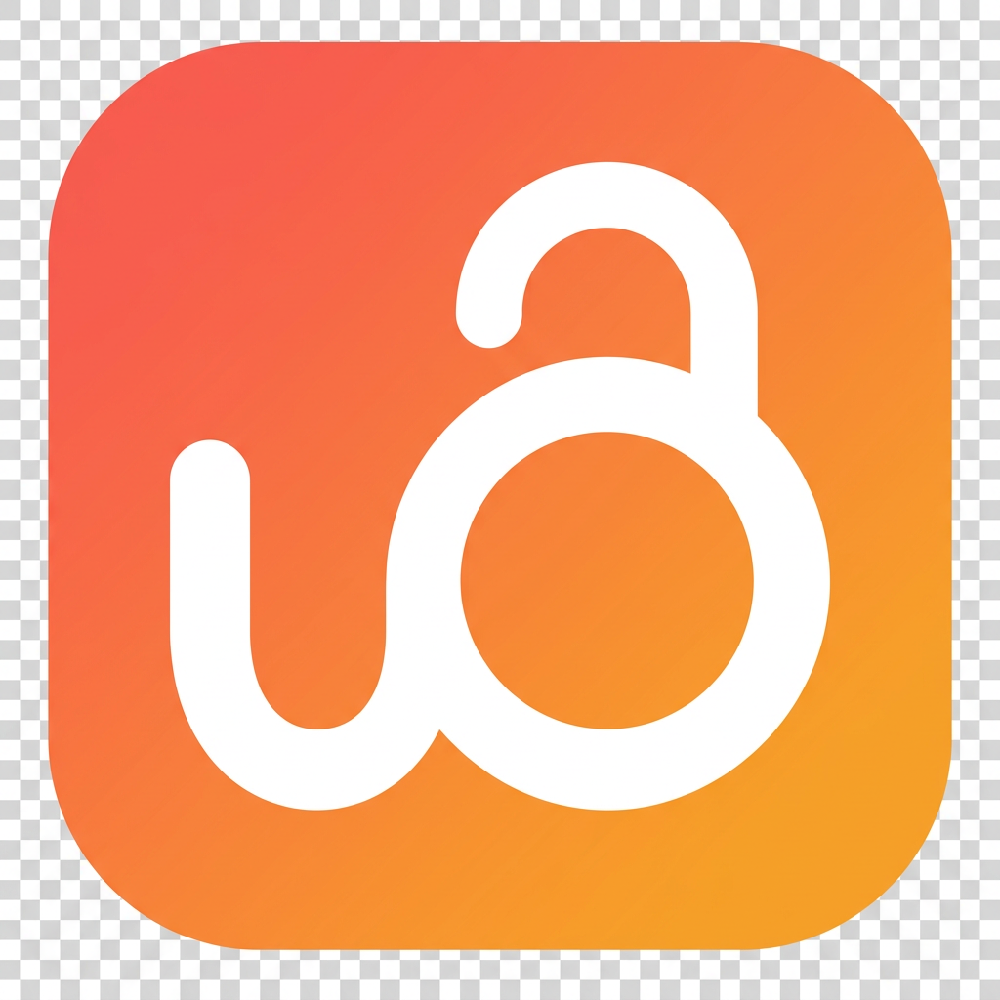
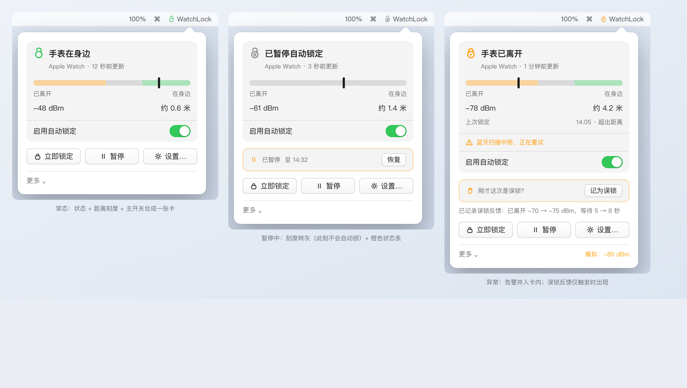
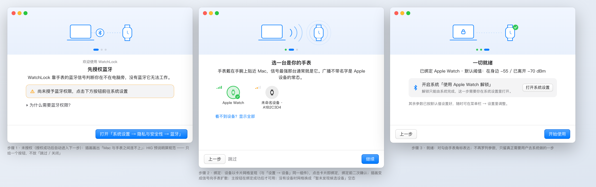
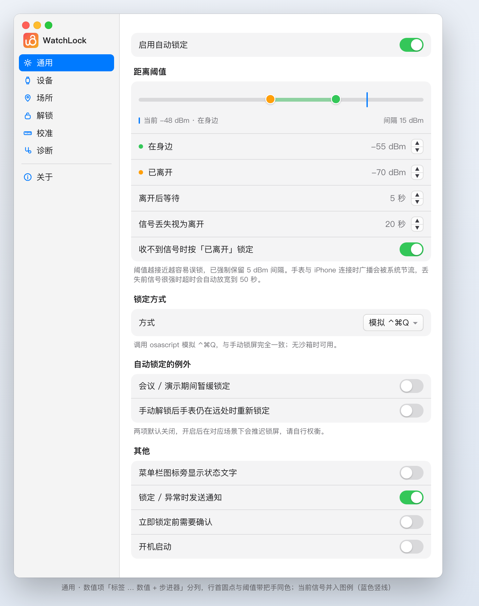
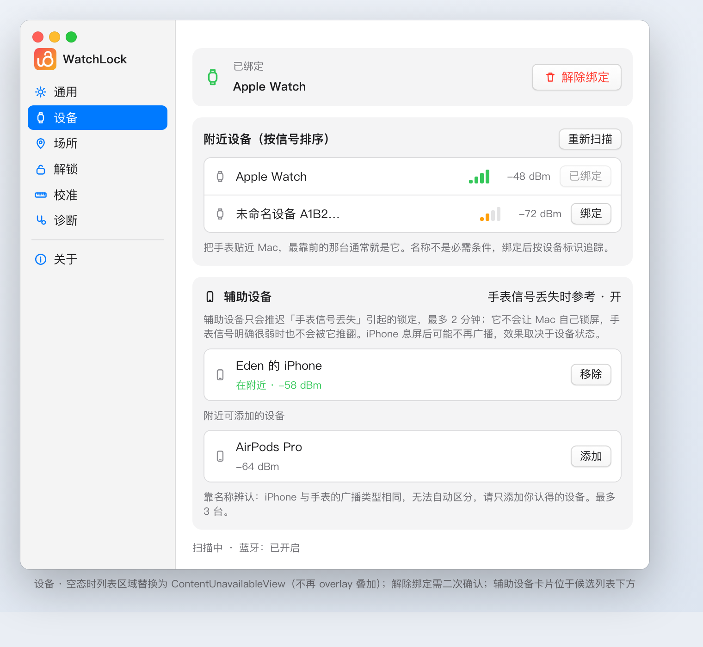
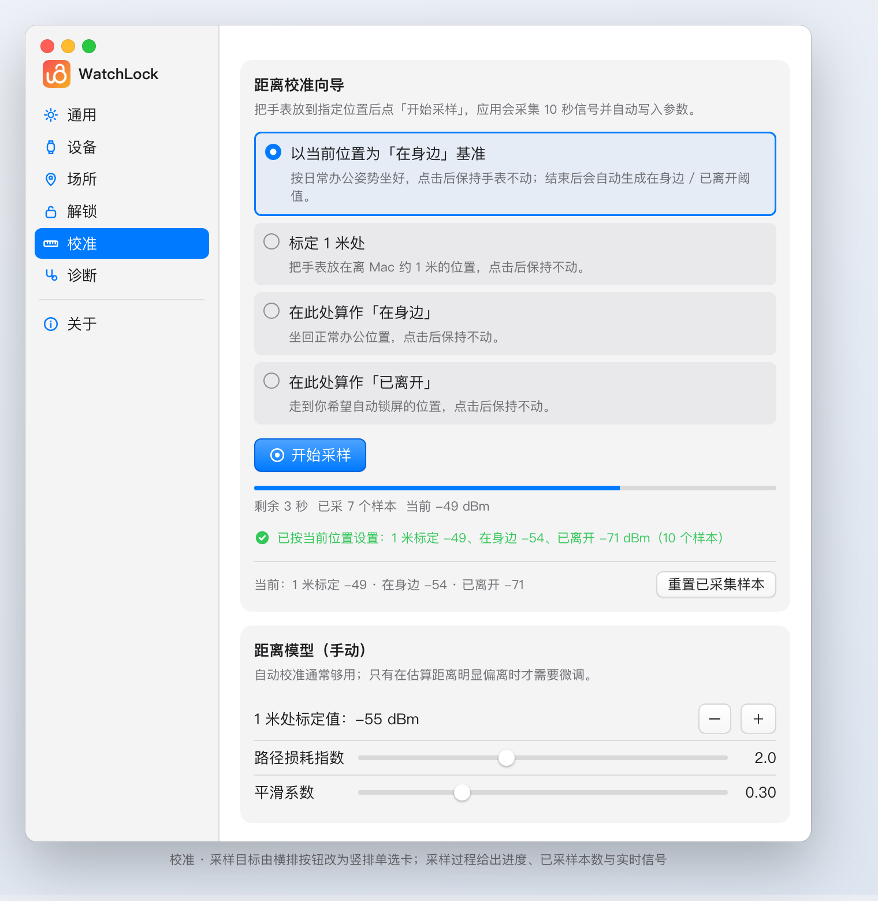
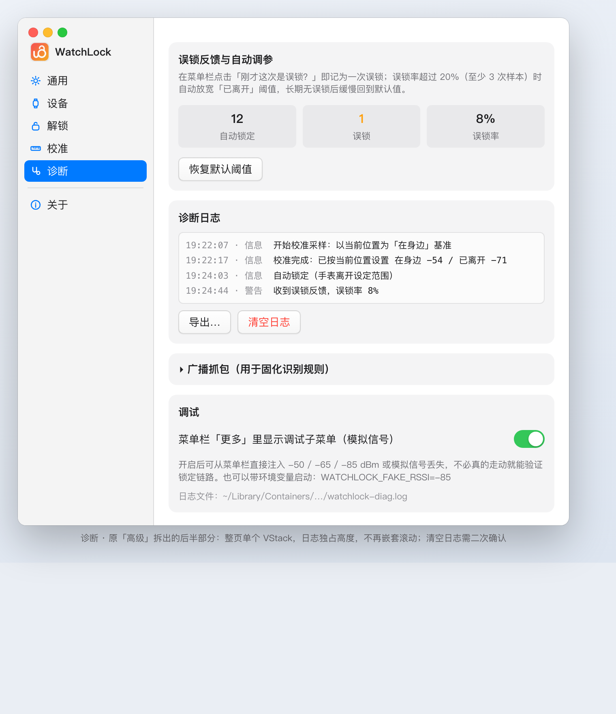

  

  # WatchLock

  **戴上手表走开，Mac 自动锁屏。回来，自动唤醒。**

  用 Apple Watch 与 Mac 之间的蓝牙距离，替你完成「离开工位就锁屏」这件总被忘记的事。

  macOS 14+ · 菜单栏常驻 · 无网络请求 · 不接触你的密码

  [获取方式](#获取方式) · [常见问题](#常见问题) · [开源许可](#开源与许可)

---

## 它会替你做什么

你不需要按任何快捷键，也不需要记得锁屏。手表在你手腕上，它就是你的钥匙。

- **离开即锁** —— 手表超出设定范围并持续数秒，Mac 自动锁屏。
- **回来即亮** —— 回到工位，屏幕自动点亮，解锁交给系统自带的「使用 Apple Watch 解锁」。
- **状态随时可见** —— 菜单栏实时显示信号强度、当前判定与最近一次锁定原因。
- **一键掌控** —— 点开菜单栏可立即锁定、临时暂停，或查看信号曲线。

## 全部功能

| | 功能 | 说明 |
| --- | --- | --- |
| 🔒 | **自动锁定** | 基于蓝牙信号强度判定距离，跨过「已离开」阈值并持续设定秒数后锁屏 |
| 💡 | **靠近唤醒** | 回到范围内点亮显示器，解锁由 macOS 原生能力完成 |
| 📊 | **信号与阈值可视化** | 同轴阈值带直观显示当前信号落在「在身边 / 边界 / 已离开」哪一段 |
| 🎯 | **距离校准向导** | 保持办公姿势 10 秒，按你的实际环境自动生成阈值，不用自己猜数字 |
| 🔁 | **误锁反馈与自动调参** | 标记误锁后自动放宽阈值，越用越贴合你的习惯 |
| 🔔 | **异常通知** | 蓝牙异常、信号长期丢失、权限缺失时主动告知，并给出处理指引 |
| ⚙️ | **锁屏方式可选** | 模拟 ⌃⌘Q（默认）、仅关闭显示器、或自定义命令 |
| 🔐 | **开机启动 / 睡眠联动** | 开机即守护，唤醒后给一段宽限期避免误判 |

## 隐私：我们什么都不知道

这一点对健康与安全类工具尤其重要，所以写在功能之前。

- **零网络请求** —— 应用不发起任何网络连接，全部计算在本机完成。可自行验证：`lsof -i -P | grep WatchLock`。
- **不接触你的密码** —— 默认不托管、不存储、不传输任何密码；解锁完全交给系统。
- **不采集使用数据** —— 没有埋点，没有分析，没有崩溃上报。
- **最小权限** —— 只申请两项系统权限，各有明确用途（见下表）。
- **无 Dock 图标** —— 安静地待在菜单栏，不打扰你的工作流。

「托管密码自动输入」是一个可选的进阶能力，默认关闭且会明确标注风险，可完全不用。

## 快速上手

1. 打开应用，菜单栏出现锁形图标。
2. 跟随引导授权两项权限，并在「设备」里绑定你的 Apple Watch。
3. 在系统设置中开启「使用 Apple Watch 解锁」。
4. （推荐）跑一次「校准 → 距离校准向导」，按你的坐姿生成专属阈值。

之后一切自动发生。

## 系统权限

| 权限 | 为什么需要 | 不授权会怎样 |
| --- | --- | --- |
| **蓝牙** | 扫描 Apple Watch 的广播并测量距离 | 扫描不到设备，核心功能不可用 |
| **辅助功能** | 以模拟 ⌃⌘Q 的方式锁屏 | 锁定时会收到明确通知与指引 |

应用不会请求「输入监控」「屏幕录制」等无关权限。若发现它索要额外权限，请立即停用并反馈。

## 界面一览

| 设置 · 通用 | 设置 · 设备 |
| --- | --- |
|  |  |

| 设置 · 校准 | 设置 · 诊断 |
| --- | --- |
|  |  |

## 默认参数

| 参数 | 默认值 |
| --- | --- |
| 在身边阈值 | -55 dBm |
| 已离开阈值 | -70 dBm |
| 离开持续时间 | 5 秒 |
| 信号丢失超时 | 20 秒（信号很强时放宽到 2.5 倍） |
| 唤醒宽限 | 8 秒 |

## 常见问题

**手表就在旁边，为什么还是锁屏了？**

先看菜单栏的实测信号值，以它为准。手表贴近 Mac 时约 -42 dBm，默认「已离开」阈值 -70 通常够用。若仍误锁，跑一次「距离校准向导」按你的实际环境生成阈值。

**需要 Apple Watch 上装配套 App 吗？**

不需要。应用直接读取手表已有的蓝牙广播，手表端零安装、零设置。

**会耗电吗？**

应用使用系统低功耗扫描，常驻内存占用很小；手表端无需做任何事，不额外耗电。

**支持哪些 Mac 与手表？**

需要蓝牙低功耗（BLE），macOS 14 及以上。Apple Watch 各代的广播行为略有差异，应用会自动适应；若发现识别不稳定，可在「诊断 → 广播抓包」里导出信息反馈给我们。

**锁屏为什么走「模拟 ⌃⌘Q」？**

macOS 没有开放给第三方的锁屏 API，模拟系统快捷键是等效于手动锁屏的通用做法，也是唯一不依赖私有 API 的方案。你也可以改成「仅关闭显示器」或自定义命令。

**数据安全吗？会不会上传我的位置？**

不会。应用不联网，也不计算地理位置，只有「近 / 远」的相对判定。

## 获取方式

正式分发版本（Developer ID 签名 + 公证，DMG 封装）正在准备中，敬请期待。

## 已知限制

- Apple 未开放第三方自动解锁 API，解锁依赖系统自带「使用 Apple Watch 解锁」，本应用负责靠近时唤醒屏幕。
- 「托管密码自动输入」为高风险可选能力，默认关闭，需辅助功能权限。
- 金属屏蔽、USB-C 扩展坞干扰等环境因素会影响蓝牙信号，校准向导可缓解。

## 关于

**应用名**：WatchLock —— 以手表为钥匙，为 Mac 上锁。

**标识**：小写 `w` 的右笔向上绕成闭环，形似开启的锁梁；既是首字母，也是「锁」。

## 开源与许可

WatchLock 源码公开，采用 **PolyForm Noncommercial 1.0.0** 许可（见 [LICENSE](./LICENSE)）：

| | 允许 | 需要授权 |
| --- | --- | --- |
| 个人使用、学习、研究、自用 | ✅ | — |
| 学校 / 慈善 / 公共研究 / 政府等非商业机构 | ✅ | — |
| 修改源码、分发副本 | ✅（须保留许可与版权声明） | — |
| **任何商业用途**（含公司内部使用、商业产品集成、付费分发） | — | ✅ 需另行获得书面授权 |

之所以开源：一款替你锁屏的工具，理应能被你逐行检查。它声称「不联网、不碰密码、不采集数据」，代码就是这份声明的凭据。

商业授权与咨询请联系：<待填写邮箱>。

- 反馈问题、提交改进：欢迎 issue 与 PR（贡献即以相同许可授权）。
- Apple、Apple Watch、macOS 为 Apple Inc. 的商标，本项目与其无任何隶属或合作关系；「使用 Apple Watch 解锁」是 macOS 的系统能力，非本项目提供。
