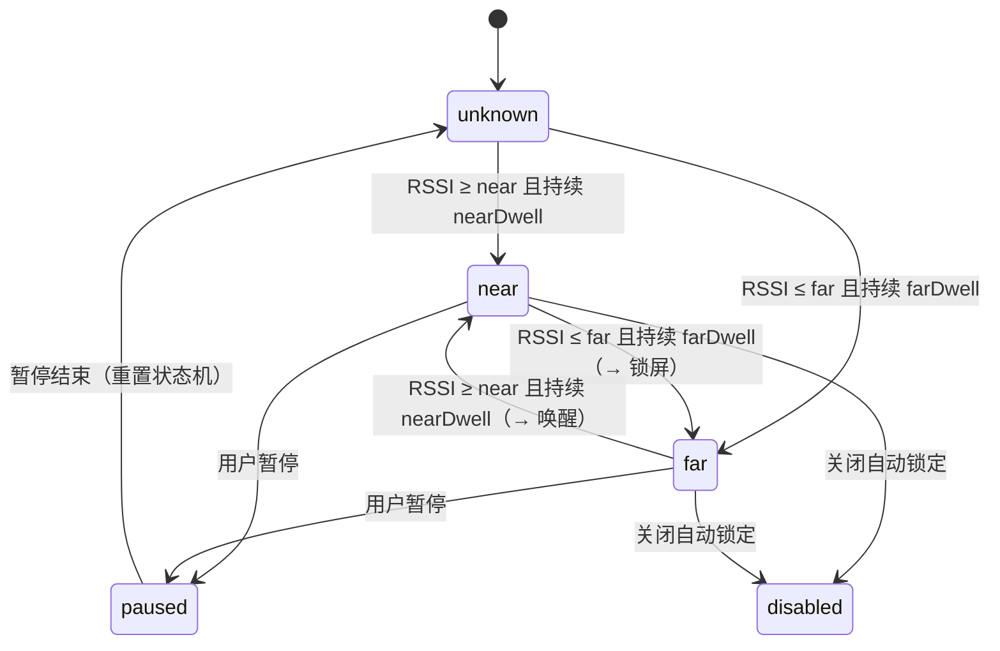

# WatchLock 需求规格说明书（SRS）

> 用 Apple Watch 的蓝牙距离自动锁定 / 唤醒 Mac 的菜单栏应用

| 项目 | 内容 |
| --- | --- |
| 产品名称 | WatchLock |
| 文档版本 | v1.0 |
| 文档状态 | 初稿（待评审） |
| 创建日期 | 2026-10-15 |
| 目标平台 | macOS 14 Sonoma 及以上（Apple Silicon / Intel 通用） |
| 配套设备 | Apple Watch（watchOS 9+，与本机蓝牙可见） |
| 编写人 | 项目初始化阶段由 AI 辅助起草 |

---

## 1. 项目背景与目标

### 1.1 背景

macOS 自带的「使用 Apple Watch 解锁」只解决了**解锁**问题，缺少对等的「离开即锁」能力：

- 系统自带自动解锁依赖 iCloud 同一账户、双因素认证、手表解锁且佩戴等条件，条件不满足时静默失效；
- 用户起身离开工位后，Mac 往往长时间保持解锁状态，存在信息泄露风险；
- 已有的第三方方案（Near Lock、MacID、Unlox 等）多为闭源付费、或依赖 iPhone 中转、或需要托管登录密码。

### 1.2 产品目标

1. **离开即锁**：Apple Watch 超出设定范围（或信号丢失）后，在可配置的宽限时间内自动锁定 Mac。
2. **靠近即醒**：手表回到范围内时点亮显示器，并尽量复用 macOS 原生的 Apple Watch 解锁流程完成解锁。
3. **零干扰**：常驻菜单栏、无 Dock 图标、低耗电、误锁率可控、状态与原因对用户透明可见。
4. **隐私优先**：默认不接触、不上传、不存储用户密码；任何高风险能力默认关闭并明确提示。

### 1.3 非目标（本期不做）

- 不做 iOS / watchOS 配套 App（M3 再评估，见 §14.3）。
- 不做 iCloud / 多设备同步、不做账号体系、不做任何网络上报。
- 不实现「绕过系统密码」的能力；不使用私有 API 做解锁。
- 不做企业管控（MDM）、不做 Windows / Linux 版本。

---

## 2. 术语表

| 术语 | 说明 |
| --- | --- |
| RSSI | Received Signal Strength Indicator，接收信号强度指示，单位 dBm，值越大信号越强（如 -45 强于 -75） |
| EWMA | 指数加权移动平均，用于平滑 RSSI 抖动 |
| 迟滞（Hysteresis） | 近/远双阈值设计，避免临界点来回抖动导致反复锁定 |
| 宽限期（Grace / Dwell） | 状态满足后仍需持续 N 秒才真正执行动作 |
| 托管密码 | 用户主动授权后，将登录密码存入钥匙串，由应用模拟键入完成解锁（高风险，默认关闭） |
| 绑定设备 | 用户在候选列表中指定的那一只 Apple Watch，后续只以它作为判定依据 |
| 信号丢失 | 超过 N 秒未收到任何广播，视为「已离开」 |

---

## 3. 用户画像与使用场景

| 角色 | 特征 | 核心诉求 |
| --- | --- | --- |
| 办公族 A | 开放式工位，频繁起身开会 | 离开工位自动锁屏，回来自动点亮 |
| 开发者 B | 多显示器、长时间编译，偶尔离开 | 可调阈值，避免去茶水间被误锁 |
| 合规敏感用户 C | 公司有锁屏合规要求 | 明确知道何时锁、为什么锁，可导出日志 |

### 3.1 典型场景

**场景 1（主流程，P0）**
1. 用户戴着 Apple Watch 在 Mac 前工作 → 状态栏显示「手表在身边」。
2. 用户起身去会议室，手表信号在 5 秒内持续低于「已离开」阈值。
3. WatchLock 在宽限期结束后执行锁屏，状态栏变为「手表已离开」，并（可选）发送通知。
4. 用户回来坐下，手表进入范围 → 点亮显示器 → 由系统「使用 Apple Watch 解锁」完成解锁（或用户手动输入密码）。

**场景 2（异常：手表没电 / 关机，P1）**
- 超过 `signalLostTimeout`（默认 20 秒）无信号 → 视为离开 → 锁定，且**明确区分**「信号丢失」与「超出距离」两种原因，避免用户以为是 bug。
- **信号丢失反误锁保护（实测问题修复）**：Apple Watch 与 iPhone 连接时广播会被系统节流，手表就在旁边也可能十几秒没有任何广播。因此
  - 丢失前最后一次平滑信号仍强于「在身边」阈值时，超时自动放宽到 `signalLostTimeout × 2.5`；
  - 设置项「收不到信号时按『已离开』锁定」（默认开）可关闭，关闭后只有信号真正变弱（超出距离）才锁定。

**场景 3（异常：开会不希望锁屏，P0）**
- 用户在菜单栏选择「暂停 1 小时」，期间不锁定；暂停到期后自动恢复并在菜单栏显示剩余时间。

**场景 4（异常：刚唤醒就被锁，P1）**
- 系统从睡眠唤醒后进入 `unlockGraceAfterWake`（默认 8 秒）宽限，且重置距离状态机，避免 RSSI 尚未稳定时误锁。

---

## 4. 产品形态与运行环境

| 项 | 要求 |
| --- | --- |
| 形态 | 常驻菜单栏应用（`LSUIElement = true`），无主窗口、无 Dock 图标 |
| 设置入口 | 菜单栏「设置…」+ 快捷键 `⌘,`，或系统设置中的登录项 |
| 系统版本 | macOS 14.0+（`MenuBarExtra` / `SMAppService` 依赖） |
| 架构 | 通用二进制（arm64 + x86_64） |
| 权限 | 蓝牙（必需）；辅助功能（使用默认「⌃⌘Q」锁屏或托管密码时必需）；通知（可选） |
| 沙箱 | 默认关闭 App Sandbox：锁屏依赖 `osascript`（模拟 ⌃⌘Q）与 `pmset`，沙箱下 System Events 会以 -600 失败；`build-app.sh --sandbox` 仅用于兼容性对照 |
| 分发 | **当前仅通过 GitHub Release 分发，不发布到 App Store**（决策日期 2026-10-16）；GitHub Actions 构建 arm64 + x86_64 通用应用并打包 DMG，发布 DMG 与 SHA-256 校验文件。CI 默认 ad-hoc 签名，无需 Apple 证书或公证；需明示 Gatekeeper 与升级后重新授权的限制。Developer ID 签名 / 公证作为后续可选增强；本地开发仍可使用稳定证书 |

---

## 5. 总体技术方案

### 5.1 链路

```
Apple Watch(BLE 广播)
      │  CoreBluetooth 持续扫描（allowDuplicates=true）
      ▼
WatchScanner ──(RSSI 样本)──▶ ProximityEngine ──(near/far 事件)──▶ AppSession
                                                                      │
                                              ┌───────────────────────┴────────────┐
                                              ▼                                    ▼
                                        ScreenLocker                          UnlockService
                                  (CGSession -suspend 等)              (点亮屏幕 / 引导系统自动解锁)
```

### 5.2 距离判定状态机



### 5.3 关键约束（必须写进设计，避免后期踩坑）

| 约束 | 说明 | 应对 |
| --- | --- | --- |
| Apple 未提供第三方自动解锁 API | 无法在第三方进程内完成「免密解锁」 | 解锁走「点亮屏幕 + 系统原生自动解锁」；托管密码作为可选高风险方案 |
| Apple Watch 广播不稳定 | 手表与 iPhone 连接时广播内容受限，设备名可能不可见 | 多证据识别（名称 / 厂商数据 / 服务 UUID）+ 用户手动绑定；M3 评估 watchOS 配套 App |
| 蓝牙 RSSI 受遮挡影响大 | 人体、金属、显示器都会造成 5–15 dBm 波动 | EWMA 平滑 + 双阈值迟滞 + 宽限期 + 可校准 |
| macOS 无公开锁屏 API | 只有工程手段 | 默认模拟 ⌃⌘Q（需辅助功能）；可选私有 `SACLockScreenImmediate`（免授权但不公开、可能失效）；可切换 `pmset` 或自定义命令（见 FR-04） |
| 沙箱内 Apple Events 受限 | 托管密码需要 Apple Events + 辅助功能 | 该功能默认关闭，且需要用户在系统设置中显式授权 |

---

## 6. 功能需求总览

| 编号 | 需求 | 优先级 | 里程碑 |
| --- | --- | --- | --- |
| FR-01 | 首次启动权限引导（蓝牙） | P0 | M1 |
| FR-02 | Apple Watch 发现与绑定 | P0 | M1 |
| FR-03 | 距离测量与状态判定 | P0 | M1 |
| FR-04 | 离开自动锁定 | P0 | M1 |
| FR-05 | 靠近唤醒 / 解锁 | P1 | M2 |
| FR-06 | 临时暂停与恢复 | P0 | M1 |
| FR-07 | 菜单栏状态与控制 | P0 | M1 |
| FR-08 | 设置界面 | P0 | M1 |
| FR-09 | 系统通知 | P2 | M2 |
| FR-10 | 开机启动 | P2 | M2 |
| FR-11 | 诊断日志与导出 | P1 | M1 |
| FR-12 | 低耗电与性能优化 | P1 | M2 |
| FR-13 | 睡眠/唤醒/锁屏事件联动 | P1 | M2 |
| FR-14 | 距离校准向导 | P2 | M3 |
| FR-15 | 本地化（简中 / 英文） | P2 | M4 |
| FR-16 | 误锁反馈与自动调参 | P1 | M3 |
| FR-17 | 调试用 RSSI 模拟（开发辅助） | P2 | M3 |
| FR-18 | 手动检查更新 | P2 | M4 |

---

## 7. 功能需求详情

### FR-01 首次启动与权限引导（P0）

1. 首次启动弹出引导页，说明需要的权限与用途。
2. 蓝牙权限：通过 `CBCentralManager` 初始化触发系统授权；未授权时菜单栏显示红色提示并提供「打开系统设置」按钮。
3. 蓝牙关闭时提示用户开启，自动重试扫描（状态变为 `.poweredOn` 后自动恢复）。
4. **验收标准**：
   - 未授权时应用不崩溃，菜单栏可见明确的修复指引；
   - 授权并开启蓝牙后，无需重启应用即可开始扫描。

### FR-02 Apple Watch 发现与绑定（P0）

1. 持续扫描 BLE 外设（`allowDuplicates = true` 以获取连续 RSSI）。
2. 候选识别采用多证据规则（满足任一即入选）：
   - 名称包含 `Apple Watch` / `watch`（不区分大小写）；
   - 厂商数据公司 ID 为 `0x004C`（Apple），并解析其中的 Continuity 广播结构（类型字节 + 声明长度，见 `AppleAdvertisement`）；
   - 命中已知 Apple 相关服务 UUID（ANCS / AMS / Continuity）；
   - 已被用户绑定（始终保留）。
3. 设置页展示候选列表（名称、RSSI、命中依据），支持「绑定 / 解绑」，绑定后仅以该设备 ID 作为判定依据。
4. 30 分钟未出现的外设从列表移除。
5. **验收标准**：
   - 手表在附近时 30 秒内出现在候选列表；
   - 绑定后重启应用仍生效（持久化 `boundWatchID`）；
   - 绑定其他设备后，原设备信号不再影响判定。

### FR-03 距离测量与状态判定（P0）

1. RSSI 使用 EWMA 平滑，平滑系数默认 0.25，可配置（0.05–1.0）。
2. 近/远双阈值：默认「在身边」≥ -55 dBm，「已离开」≤ -70 dBm。
3. 状态切换需满足持续时间：离开默认 5 秒，靠近默认 1 秒。
4. 信号丢失超时（默认 20 秒）视为离开；丢失前信号很强时放宽到 2.5 倍。
5. 提供距离估算（对数路径损耗模型），1 米处标定值默认 -55 dBm，路径损耗指数默认 2.5，均可配置。
6. **验收标准**：
   - 在临界值附近来回移动时，1 分钟内不出现「锁屏—解锁」抖动；
   - 输入固定 RSSI 序列的单元测试覆盖：平滑、迟滞、超时三类行为。

### FR-04 离开自动锁定（P0）

1. 触发条件全部满足才执行锁定：
   - 功能开关已开启且未处于暂停；
   - 不在唤醒宽限期内；
   - 当前会话未锁定（通过既有非公开 `com.apple.screenIsLocked/Unlocked` 通知跟踪）；显示器熄屏/亮屏单独记录，不代表会话锁定/解锁。
2. 锁定方式可配置（默认 `controlCommandQ` 模拟 ⌃⌘Q）：

| 方式 | 实现 | 适用场景 |
| --- | --- | --- |
| 锁定屏幕（⌃⌘Q，默认） | `osascript` 模拟 ⌃⌘Q | 与手动锁屏一致；**需要辅助功能权限**，缺权限时预检拦截并通知 |
| 锁定屏幕（系统接口，可选） | 进程内调用私有 `SACLockScreenImmediate`（`dlopen`/`dlsym`） | 免辅助功能授权；接口未公开，系统升级可能失效，失效时通知并引导回退 |
| 仅关闭显示器 | `pmset displaysleepnow` | 只想熄屏、不锁会话 |
| 进入睡眠 | `pmset sleepnow` | 期望整机休眠省电 |
| 锁定屏幕（CGSession，旧系统） | `CGSession -suspend` | 仅 macOS 14/15；macOS 26 已移除该可执行文件 |
| 自定义命令 | 用户填写 | 对接企业脚本 |

3. 执行失败时记录日志并（可选）通知，不重复高频重试。
4. **验收标准**：
   - 手表关机 15 秒后 Mac 进入锁定状态，日志中可见原因；
   - 已锁屏状态下不会重复触发锁屏命令；
   - 暂停期间即使手表离开也不锁定。
5. **自动锁定的两个例外（均默认关闭，由 `LockGate` 实现）**——它们会让「该锁没锁」，所以必须由用户主动开启：
   - **会议 / 演示豁免**：开启后，状态机判定离开时若有应用持有「阻止显示器睡眠」断言（`PreventUserIdleDisplaySleep`），则暂缓锁定、菜单栏提示，持有者消失后补锁；暂缓有**硬上限**（默认 60 分钟，可设 5–240），到点无论如何都锁；用户主动运行的 `caffeinate` 与系统 `powerd` 不计入；查不到断言表时按「没有持有者」处理（照常锁屏）。
   - **手动解锁后重新布防**：开启后，用户手动解锁时若手表仍判定为「已离开」，则键鼠空闲满设定时间（默认 5 分钟，可设 1–60）后再锁一次；按空闲而非固定延时，避免在用户操作中突然锁屏；查不到空闲时长时不锁。此类锁定不计入误锁反馈 / 自动调参样本。
   - 手表回到身边、暂停 / 关闭、整机睡眠、会话已锁定、蓝牙不可用时，待处理的暂缓 / 布防一律取消。

### FR-05 靠近唤醒与解锁（P1）

1. 靠近事件触发时，通过公开 `IOPMAssertionDeclareUserActivity` 请求点亮显示器；锁屏不应阻断此请求。检查 IOKit 返回码并独立监听 `screensDidWake` 通知确认，不能把请求接受视为实际亮屏或解锁。失败或冷却拦截后，只在冷却结束且收到新的有效近距离样本时重试一次；暂停、关闭、远离、停止监听或整机睡眠时不执行。官方依据及待真机验证边界见 `DEVELOPMENT.md`。
2. 解锁策略三选一，默认「系统自动解锁（推荐）」：

| 策略 | 行为 | 风险 |
| --- | --- | --- |
| 仅唤醒屏幕 | 只点亮显示器，解锁交给用户或系统 | 无 |
| 系统自动解锁（默认） | 点亮 + 检查系统前置条件（`sysadminctl -screenLock status` 是否为「立即」、`LAContext` companion 策略是否报告附近有可用 Apple Watch），缺失时引导到系统设置；探测结果无法识别时不报缺失 | 无 |
| 托管密码自动输入 | 从钥匙串读取密码，Apple Events 模拟键入 | 高：需辅助功能权限，密码以 `WhenUnlockedThisDeviceOnly` 存钥匙串，系统更新可能失效 |

3. 必须在 UI 上明示：Apple 未开放第三方自动解锁 API，最可靠路径是开启系统「使用 Apple Watch 解锁」。
4. **验收标准**：
   - 默认策略下靠近后显示器点亮，且不会尝试写入/读取任何密码；
   - 托管密码关闭时不读取钥匙串；开启时若无辅助功能权限，明确报错并给出授权入口。

### FR-06 临时暂停与恢复（P0）

1. 支持暂停 15 分钟 / 1 小时 / 4 小时，或手动「恢复」。
2. 暂停期间菜单栏显示状态与到期时间，暂停结束自动恢复。
3. 暂停状态持久化，应用重启后仍生效。

### FR-07 菜单栏状态与控制（P0）

1. 常驻图标随状态变化五态：`在身边 / 已离开 / 搜索中 / 已暂停 / 已关闭`。图标由 logo 提炼（环形锁体 + 锁梁），代码绘制为模板图，设计见 `docs/ui-design/08-menubar-icons.html`。同一套图标同时用于面板状态卡（`StatusIcon`），两处图形与状态映射必须一致。
2. 面板内容：状态标题、绑定设备名、信号强度、估算距离、最后更新时间、上次锁定（时间 · 原因，仅本次运行内有效）、蓝牙异常提示、未绑定手表提示。
3. 快捷操作：启用开关、暂停菜单、立即锁定、设置、退出。

### FR-08 设置界面（P0）

| 页签 | 内容 |
| --- | --- |
| 通用 | 启用开关、近/远阈值、离开等待、信号丢失超时、锁定方式（默认 ⌃⌘Q；选「系统接口」时显示该私有 API 的可用性与失效风险）及自定义命令、菜单栏文字、通知、开机启动 |
| 设备 | 已绑定设备、候选列表与绑定/解绑、排查提示 |
| 解锁 | 点亮屏幕开关、解锁策略、唤醒宽限、托管密码录入（高风险）、系统自动解锁引导入口 |
| 校准 | 距离校准向导、距离模型手动调整（1m 标定值、路径损耗指数、平滑系数） |
| 诊断 | 误锁反馈与自动调参统计、诊断日志（查看/清空/导出）、广播抓包、调试开关 |
| 关于 | 品牌标识、版本、用途说明、重新运行首次启动引导 |

### FR-09 系统通知（P2）

1. 触发时机：执行自动锁定、蓝牙被关闭、权限缺失、自动解锁前置条件缺失。
2. 通知频率限制：同一原因 5 分钟内最多 1 条。
3. 可在设置中整体关闭。
4. 蓝牙不可用（关闭 / 重置 / 无权限 / 不支持）期间：**暂停信号丢失结算**并发一条通知说明原因（蓝牙不可用不等于手表离开）；恢复后重置状态机并给一段宽限期（复用 `unlockGraceAfterWake`）。仅在已绑定手表、已启用且未暂停时通知。
5. 未绑定手表时，真实设备的广播一律不参与判定（只有调试模拟信号例外），菜单栏提示去绑定。

### FR-10 开机启动（P2）

1. 使用 `SMAppService.mainApp`（macOS 13+）注册/注销登录项，失败时记录日志。
2. 设置项与系统登录项状态保持一致显示。

### FR-11 诊断日志与导出（P1）

1. 内存环形日志，最多 300 条，含时间戳与级别（信息/警告/错误）。
2. 记录：启动退出、扫描状态变化、阈值切换、锁定触发与原因、权限错误、解锁失败。
3. 支持「诊断」页查看、清空、导出为 `.txt`（用户自选路径）。
4. 日志中**不得**出现密码、钥匙串内容。

### FR-12 低耗电与性能（P1）

| 指标 | 目标 |
| --- | --- |
| 常驻 CPU 占用（1 分钟均值） | < 1% |
| 常驻内存 | < 60 MB |
| 电池影响（`powermetrics` 对比） | 不明显高于同类蓝牙工具类应用 |
| 状态刷新间隔 | 1 秒（结算），RSSI 由广播驱动 |
| 二进制体积 | < 5 MB |

### FR-13 睡眠 / 唤醒 / 锁屏事件联动（P1）

1. 监听 `NSWorkspace` 的 willSleep / didWake / screensDidSleep / screensDidWake，以及分布式通知 `com.apple.screenIsLocked` / `screenIsUnlocked`。
2. 唤醒后进入宽限期并重置距离状态机，避免 RSSI 未稳定时误锁。
3. 整机睡眠期间停止扫描，系统先唤醒后恢复；不承诺依靠手表 BLE 唤醒整机或合盖的 Mac。显示器熄屏不停止扫描，也不视为会话已锁定。

### FR-14 距离校准向导（P2，M3 → 已提前交付）

1. 引导用户把手表放在 1 米处采样 10 秒，自动写入 `measuredPower`。
2. 支持「在此处算作在身边 / 已离开」两点标定，自动生成阈值。
3. **实现说明**：采样结果取中位数抑制离群值；两点标定按「在身边中位数 - 3 dBm / 已离开中位数 + 3 dBm」生成阈值，并保证两者至少相差 8 dBm（不足时优先下压「已离开」阈值以降低误锁率）。入口在「设置 → 校准 → 距离校准向导」。

### FR-16 误锁反馈与自动调参（P1，M3）

1. 每次自动锁定记一次样本；用户在菜单栏点击「刚才这次是误锁」记一次误锁（锁定后 10 分钟内可反馈）。
2. 误锁率 > 20% 且样本 ≥ 3 时自动放宽：先把「已离开」阈值下调 2 dBm（下限 -95），到下限后把等待时间 +2 秒（上限 30 秒）。
3. 连续 20 次自动锁定无误锁时缓慢收紧：先缩短等待时间，再向默认阈值移动 1 dBm；收紧后不会比默认行为更激进，也不会与「在身边」阈值贴太近（至少保留 5 dBm）。
4. 「诊断」页展示自动锁定次数 / 误锁次数 / 误锁率，并提供「恢复默认阈值」。
5. **实现说明**：调参逻辑为纯函数 `AutoTuner`，有单元测试；样本计数持久化在 `UserDefaults`。

### FR-17 调试用 RSSI 模拟（P2，M3）

1. 菜单栏「调试」子菜单可注入固定 RSSI（在身边 / 边界 / 离开）或模拟信号丢失，用于无需走动即可验证状态机与锁屏链路。
2. 支持环境变量 `WATCHLOCK_FAKE_RSSI=<dBm>` 在启动时持续注入。
3. 模拟期间忽略真实广播，避免两者相互干扰；开关受「设置 → 通用 → 菜单栏显示调试子菜单」控制，默认关闭。

### FR-15 本地化（P2，M4）

1. 简体中文、英文两套文案，随系统语言切换（`Resources/Localization/{zh-Hans,en}.lproj`，由 `Scripts/build-app.sh` 复制进 App 包；`CFBundleLocalizations` 声明两种语言）。
2. 源码里的中文字面量即键（开发语言 = 简中）；`Scripts/localization.py check` 用编译器 `-emit-localized-strings` 提取键并与英文译文逐条比对（缺失、多余都会失败），`sync` 重新生成简中恒等映射。
3. 权限弹窗文案（`NSBluetoothAlwaysUsageDescription` 等）走 `InfoPlist.strings` 本地化。
4. 帮助手册：`docs/help.md`（简中）、`docs/help.en.md`（英文），「设置 → 关于」的「帮助手册」按系统语言打开对应页面。
5. 未验证：在两种系统语言下逐页目视核对布局（英文通常更长，可能有截断），需真机检查。

### FR-18 手动检查更新（P2，M4）

1. 「设置 → 关于」提供「检查更新」按钮，**只在点击时**向 `https://github.com/MaelWeb/WatchLock/releases/latest` 发一次请求，读取其跳转目标 `.../releases/tag/vX.Y.Z` 得到最新版本号（不走 api.github.com，没有匿名限流）；不做后台轮询，不带任何本机信息。
2. 有新版本只提供「前往下载」打开 Releases 页面，**不自动下载、不自动安装**。
3. 版本比较按数字逐段，忽略预发布后缀；任一侧无法解析时不提示更新。
4. 沙箱构建需要 `com.apple.security.network.client`（已加入 entitlements）；默认不沙箱的构建不受影响。

---

## 8. 非功能需求

| 编号 | 类别 | 需求 |
| --- | --- | --- |
| NFR-01 | 安全 | 默认不收集/不上传任何数据；默认无网络，唯一例外是用户手动点击「检查更新」时的一次 GitHub 请求（FR-18 / ADR-13）；密码仅存钥匙串且 `WhenUnlockedThisDeviceOnly`；日志脱敏 |
| NFR-02 | 可靠 | 蓝牙异常、权限缺失、命令执行失败均不崩溃；关键路径有日志 |
| NFR-03 | 可维护 | 分层清晰（UI / Session / Core / Storage），核心状态机有单元测试 |
| NFR-04 | 兼容 | macOS 14/15/26 三档验证；Apple Silicon 与 Intel 双架构 |
| NFR-05 | 可用 | 首次配置 3 步内完成（授权 → 绑定 → 设定阈值）；默认参数开箱可用 |
| NFR-06 | 无障碍 | 支持 VoiceOver 可读的状态文案与控件标签 |
| NFR-07 | 可观测 | 所有锁定动作可追溯（时间 + 原因 + RSSI） |

---

## 9. 数据模型

| 对象 | 字段 | 持久化 |
| --- | --- | --- |
| `DiscoveredWatch` | id(UUID)、name、rssi、lastSeen、matchReasons | 内存 |
| `SettingsStore` | isEnabled、boundWatchID/Name、nearRSSI、farRSSI、smoothing、farDwell、nearDwell、signalLostTimeout、measuredPower、pathLossExponent、lockMethod、customLockCommand、unlockStrategy、wakeDisplayOnApproach、unlockGraceAfterWake、pauseUntil、launchAtLogin、showRSSIInMenuBar、notificationsEnabled、debugLogging | `UserDefaults` |
| `ProximityEngine.Config` | 由设置派生 | 内存 |
| 登录密码 | — | 钥匙串 `com.watchlock.login-password`（仅托管模式） |
| 诊断日志 | 时间戳、级别、消息 | 内存（可导出） |

默认值：

| 参数 | 默认值 | 说明 |
| --- | --- | --- |
| `nearRSSI` | -55 dBm | 判定「在身边」 |
| `farRSSI` | -70 dBm | 判定「已离开」 |
| `smoothing` | 0.25 | EWMA 系数 |
| `farDwell` | 5 s | 离开持续时间 |
| `nearDwell` | 1 s | 靠近持续时间 |
| `signalLostTimeout` | 20 s | 信号丢失超时（手表在旁边但广播被节流时放宽到 2.5 倍） |
| `lockOnSignalLoss` | true | 收不到信号时是否按「已离开」锁定 |
| `measuredPower` | -55 dBm | 1 米标定 |
| `pathLossExponent` | 2.5 | 路径损耗指数 |
| `unlockGraceAfterWake` | 8 s | 唤醒宽限 |

---

## 10. 界面需求

### 10.1 菜单栏面板（宽 340pt）

自上而下：状态卡（图标 / 状态 / 绑定设备名 / 信号条 / dBm / 估算距离 / 最后更新）→ 启用开关 →
（按需出现）扫描告警行、暂停状态条、误锁反馈条 → 三个等宽主操作「立即锁定 / 暂停 / 设置…（⌘,）」→
分隔线 → 「更多」菜单（调试子菜单、退出）。常驻只保留 3 个主操作，退出与调试收进「更多」以降低误触。
三种场景的设计稿见 `docs/ui-design/01-menubar.png`。

### 10.2 设置窗口（默认 760 × 660，最小 680 × 620）

左侧自绘侧栏（顶部品牌行 + 六个页面）：通用 / 设备 / 解锁 / 校准 / 诊断 / 关于（见 FR-08 表）。
窗口无原生标题栏条，红绿灯悬浮在内容之上，规范见 `.codebuddy/rules/watchlock-ui.md` §7。

### 10.3 视觉与交互

- 遵循系统强调色与深色模式，不使用自定义主题；
- 危险操作（托管密码、解除绑定）需二次确认或明确警示文案；
- 所有开关即时生效，无需重启应用。

---

## 11. 权限与隐私清单

| 权限 | 必需性 | 用途 | Info.plist 键 |
| --- | --- | --- | --- |
| 蓝牙 | 必需 | 扫描 Apple Watch 并读取 RSSI | `NSBluetoothAlwaysUsageDescription` |
| 通知 | 可选 | 锁定/异常提醒 | `NSUserNotificationUsageDescription` |
| Apple Events | 可选（仅托管密码） | 模拟键入登录密码 | `NSAppleEventsUsageDescription` |
| 辅助功能 | 使用「⌃⌘Q」锁屏（默认）或托管密码时必需 | System Events 模拟按键；缺失时锁定被拦截并通知用户，授权需用户手动勾选（分发包无法预授权，除非 MDM 下发 PPPC） | — |
| 网络 | 仅手动检查更新 | 只在点击「检查更新」时向 GitHub 发一次请求，其余时间不发起任何网络请求 | — |

---

## 12. 关键决策记录（ADR 摘要）

| 编号 | 决策 | 备选方案 | 理由 |
| --- | --- | --- | --- |
| ADR-01 | 用 BLE RSSI 做距离判定 | UWB / Wi-Fi RTT / 摄像头人感 | 仅 Apple Watch Series 6+ 支持 UWB 且不向第三方开放；RSSI 是唯一通用可行方案 |
| ADR-02 | 锁屏默认模拟 ⌃⌘Q，私有 `SACLockScreenImmediate` 作为**可选**方式 | 默认用 `CGSession -suspend`（macOS 26 已移除） | ⌃⌘Q 为公开手段、可预期；私有接口免辅助功能授权，但接口未公开、可能随系统升级失效，故仅作为用户主动选择项，不在默认值里引入风险。依据：符号名与「系统内部用于锁定屏幕」的用法见 Stack Overflow 一手回答（`SACLockScreenImmediate` in `login.framework`）；是否真能锁屏待真机验证 |
| ADR-03 | 解锁默认不托管密码 | 托管密码为默认 | 安全优先；Apple 未开放第三方解锁 API，托管密码存在泄漏与失效风险 |
| ADR-04 | SwiftPM 工程 + 脚本打包 .app；包级声明 Swift 5 语言模式 | Xcode .xcodeproj / 仅目标级语言模式 | 便于命令行构建与 CI；GUI 相关资源由 `Scripts/build-app.sh` 注入 Info.plist 与 entitlements；旧 SwiftPM 的 Universal XCBuild 路径按包级列表校验目标语言模式，避免空候选列表导致 `SWIFT_VERSION` 缺失；官方源码依据见 `DEVELOPMENT.md` |
| ADR-05 | SwiftUI `MenuBarExtra` | NSStatusItem 手写 | 代码量小、macOS 14+ 原生支持 `.window` 样式面板 |
| ADR-06 | 状态判定用双阈值 + 宽限 | 单一阈值 | 抑制临界抖动，降低误锁率 |
| ADR-07 | 本期不实现 watchOS 配套 App | 手表端主动广播 / iPhone 中转 | 后台广播持续性无保证、签名与维护成本高；现有多证据识别 + 校准 + 误锁调参已覆盖主要问题。评估全文见 `docs/watchos-companion-evaluation.md` |
| ADR-08 | 定位为「离开即锁屏」，不追求复刻 Apple 官方识别可靠性 | 自己实现手表在场判定 + 解锁 | Apple 官方「用 Apple Watch 解锁」依赖 iCloud 身份 + 双重认证 + Continuity，第三方无对应 API；官方方案只覆盖解锁、不覆盖离开锁屏，本项目补的正是这一段。依据见 `docs/anti-false-lock-research.md` |
| ADR-09 | 仅通过 GitHub Release 分发，GitHub Actions 构建通用 DMG；CI 默认 ad-hoc 签名 | App Store；先等 Developer ID 公证再发布 | 用户指定 GitHub 流水线打包与 Release 渠道；DMG 打包不依赖 Apple 证书。明示未公证、Gatekeeper 与升级后重新授权风险，签名 / 公证保留为后续增强 |
| ADR-10 | 靠近时用公开用户活动断言请求亮屏，显示器 / 会话 / 整机睡眠独立跟踪 | 仅启动 caffeinate 并视为成功；锁屏时跳过唤醒 | 锁屏不能阻断亮屏；IOKit 返回码与 NSWorkspace 显示器通知分别记录请求结果和系统唤醒报告，避免把亮屏视为解锁；官方头文件及文档依据见 `DEVELOPMENT.md`，锁屏亮屏效果待真机验证 |
| ADR-11 | 外围系统探测改用可验证来源：锁屏延迟读 `sysadminctl -screenLock status`；手表认证条件用 `LAContext` companion 策略；会话锁定用 `CGSessionCopyCurrentDictionary` 校正通知状态；监听期间持有 `userInitiatedAllowingIdleSystemSleep` 活动 | 读 `defaults askForPassword`；`system_profiler` 文本匹配；仅信任私有通知；不做 App Nap 防护 | 旧探测在 macOS 26 上读不到键 / 匹配的是未连接条目，会误报「无法自动解锁」；探测无法识别时一律不报缺失。companion 策略**只用于前置条件提示，未接入锁屏判定**（走远后是否变为不可用无证据）。依据与实测见 `docs/anti-false-lock-research.md` §6.1 |
| ADR-12 | 自动锁定增加「闸门」`LockGate`：会议 / 演示豁免（读电源断言，暂缓 + 硬上限）与手动解锁后重新布防（键鼠空闲判据），**两项都默认关闭**，纯逻辑与系统探针分离、时间与探针均可注入 | 默认开启豁免；固定延时重新布防；用窗口 / 摄像头 / 麦克风占用判断会议 | 豁免会让「该锁没锁」，必须 opt-in 并有硬上限；断言接口已在**沙箱 .app**（与发布包相同 entitlements）内实测可读他进程断言（裸命令行程序带沙箱会 133 退出，不能用于验证），摄像头 / 麦克风判断需要额外权限与更多隐私面，不采用；空闲判据避免在用户操作中突然锁屏。依据与实测见 `docs/anti-false-lock-research.md` §6.2 |
| ADR-13 | 更新只做「手动检查 + 跳转下载页」：点击才发一次 GitHub 请求，不自动下载 / 安装；「零网络」改为「默认零网络，唯一例外是手动检查更新」并同步 README / 引导页 / 帮助手册 | Sparkle 式自动更新；后台定时检查；应用内替换自身 | 应用未做 Developer ID 签名 / 公证，原地替换会让蓝牙 / 辅助功能授权失效并可能被 Gatekeeper 拦截；自动更新需要常驻网络与更新签名密钥，与「一款替你锁屏的工具应能被逐行检查」的定位冲突。只读版本号的跳转目标不带任何本机信息 |

---

## 13. 里程碑与交付计划

| 里程碑 | 版本 | 内容 | 产出 |
| --- | --- | --- | --- |
| M1 | v0.1.0 | FR-01/02/03/04/06/07/08/11 骨架实现 + 构建脚本 | 可运行的 .app |
| M2 | v0.2.0 | FR-05/09/10/12/13，补 `ProximityEngine` 单元测试 | 完整主流程可用 |
| M3 | v0.3.0 | FR-14 校准向导、FR-16 误锁反馈与自动调参、FR-17 调试模拟、评估 watchOS 配套 App | 精度与体验优化（**已完成**） |
| M3.5 | v0.4.0 | UI 重构与设计规范、品牌 logo 与图标、菜单栏五态图标、产品化 README、开源许可 | 对外发布前的体验与品牌打磨（**已完成**，当前阶段） |
| M4 | v1.0.0 | GitHub Actions 通用 DMG 打包与 GitHub Release（流水线已实现）；FR-15 本地化、帮助手册（已实现）、FR-18 手动检查更新（已实现）；Developer ID 签名 / 公证为可选增强 | GitHub Release 对外发布（不发布 App Store） |

### 13.1 当前代码与需求的对照

| 需求 | 状态 | 位置 |
| --- | --- | --- |
| FR-02 扫描与绑定 | 已实现（多证据识别 + Continuity 广播解析 + 地址轮换时用广播类型指纹校验续接） | `Core/Bluetooth/WatchScanner.swift`、`Core/Bluetooth/AppleAdvertisement.swift` |
| 广播抓包（真机固化识别规则） | 已实现（「诊断」页展示厂商数据并支持复制） | `UI/Settings/DiagnosticsPage.swift` |
| FR-03 距离判定 | 已实现 | `Core/Proximity/ProximityEngine.swift` |
| FR-04 自动锁定 | 已实现（默认 ⌃⌘Q；可选私有 `SACLockScreenImmediate` 免授权，运行时解析 + 降级通知；可选「会议 / 演示暂缓」与「手动解锁后重新布防」，默认关闭） | `Core/Lock/ScreenLocker.swift`、`Core/Lock/SystemLockScreen.swift`、`Core/Lock/LockGate.swift`、`Core/System/PowerAssertionProbe.swift`、`App/AppSession.swift` |
| FR-05 唤醒解锁 | 已实现（策略骨架，需真机调优） | `Core/Unlock/UnlockService.swift` |
| FR-06 暂停 | 已实现 | `Storage/SettingsStore.swift` |
| FR-07/08 UI | 已实现（状态卡与菜单栏同源五态图标；通用页「锁定方式」含私有接口可用性提示） | `UI/MenuBarView.swift`、`UI/SettingsView.swift`、`UI/Design/StatusIcon.swift` |
| FR-11 日志 | 已实现 | `Support/DiagnosticsLog.swift` |
| FR-09 通知 | 已实现（含授权请求与「同一原因 5 分钟 1 条」限流） | `Support/NotificationPresenter.swift`、`Support/NotificationThrottle.swift` |
| FR-10 开机启动 | 已实现（设置项与系统登录项状态同步） | `Core/System/LaunchManager.swift`、`UI/SettingsView.swift` |
| FR-01 首次引导页 | 已实现（授权 → 绑定 → 确认参数 3 步向导，「关于」页可重跑） | `UI/OnboardingView.swift` |
| FR-13 睡眠联动 | 已实现（睡眠停止扫描、唤醒恢复扫描并重置状态机） | `Core/System/SleepWakeMonitor.swift`、`App/AppSession.swift` |
| FR-12 低耗电 | 已实现（暂停/关闭时改为间歇扫描、候选 60 秒清理；监听期间声明 `userInitiatedAllowingIdleSystemSleep` 活动防 App Nap，暂停/关闭时释放） | `Core/Bluetooth/WatchScanner.swift`、`Core/System/MonitoringActivity.swift`、`App/AppSession.swift` |
| FR-14 距离校准向导 | 已实现（1 米标定 + 两点标定生成阈值，采样 10 秒） | `Core/Proximity/DistanceCalibrator.swift`、`UI/CalibrationWizard.swift` |
| FR-16 误锁反馈与自动调参 | 已实现（菜单栏反馈入口 + `AutoTuner` 纯逻辑 + 诊断页统计与恢复默认） | `Core/Proximity/AutoTuner.swift`、`App/AppSession.swift`、`UI/MenuBarView.swift` |
| FR-17 调试用 RSSI 模拟 | 已实现（调试子菜单 + `WATCHLOCK_FAKE_RSSI` 环境变量，默认关闭） | `App/AppSession.swift`、`UI/MenuBarView.swift` |
| watchOS 配套 App | 已评估，结论「本期不实现」（保留为兜底方案，触发条件见评估文档） | `docs/watchos-companion-evaluation.md` |
| UI 重构与设计规范 | 已实现（设计 token 与组件库、自绘侧栏设置窗口、无标题栏窗口、同轴阈值带、引导与校准向导重做） | `UI/`、`docs/ui-design.md`、`.codebuddy/rules/watchlock-ui.md` |
| 品牌标识与状态图标 | 已实现（logo 提炼「环形锁体 + 锁梁」，应用图标 `.icns` + 代码绘制的模板图；**菜单栏与面板状态卡同源**，经 `StatusIcon`） | `UI/Design/BrandLogo.swift`、`UI/Design/MenuBarIcon.swift`、`UI/Design/StatusIcon.swift`、`docs/logo/` |
| GitHub Release 发布链路 | 流水线已实现（手动选择 patch / minor / major 自动递增版本、打包后创建标签并在同一次运行发布；保留已有标签发布与 build-only 仅打包；重跑复用本次标签；默认 ad-hoc，首次云端执行待验证） | `.github/workflows/release.yml`、`Scripts/next-version.py`、`Scripts/build-app.sh`、`Scripts/build-dmg.sh` |
| 发布版本测试 | 已实现（15 例，覆盖递增、数值排序、预发布过滤、初始版本及同一流水线重跑保护） | `Tests/ReleaseTests/test_next_version.py` |
| 开源许可 | PolyForm Noncommercial 1.0.0（禁止商用） | `LICENSE` |
| 单元测试 | 已实现（189 个用例，覆盖状态机 / 命令拼装 / 识别规则 / 限流 / 设置 / 校准 / 调参 / 广播解析 / UI 逻辑 / 菜单栏图标 / 私有接口锁屏的注入式行为 / 前置条件探测 / 会话锁定校正 / 监听活动） | `Tests/WatchLockTests` |

---

## 14. 测试与验收

### 14.1 单元测试（`Tests/WatchLockTests`，`swift test` 共 189 例）

| 用例 | 输入 | 期望 |
| --- | --- | --- |
| RSSI 平滑 | 序列 -70,-50,-70,-50 | 输出介于极值之间，无跳变 |
| 离开迟滞 | RSSI 在 -69/-71 间抖动 | 不触发锁定 |
| 离开锁定 | 持续 -75 超过 5 秒 | 触发一次 `becameFar` |
| 信号丢失 | 12 秒无样本 | 触发一次 `becameFar` |
| 靠近恢复 | 持续 -50 超过 1 秒 | 触发一次 `becameNear` |
| 距离估算 | RSSI = -55 | ≈ 1.0 米 |
| 锁屏命令拼装 | 各 `LockMethod` | 命令字符串符合预期 |
| AppleScript 转义 | 密码含 `"` `\` | 转义结果可被 `osascript` 正确解析 |
| 校准中位数 | -50 / -52 | -51（偶数取中间两数均值） |
| 两点标定 | 在身边 -50、已离开 -75 | 生成 -53 / -72，且两点能被正确分类 |
| 误锁调参 - 放宽 | 5 次锁定中 2 次误锁 | 已离开阈值 -70 → -72 |
| 误锁调参 - 收紧 | 连续 20 次无误锁、当前 -75 | 向默认阈值移动 1 dBm（-74），且不会比默认更激进 |

### 14.2 手工验收清单

1. 全新系统安装后启动，蓝牙授权流程可走通；
2. 绑定手表后，把手表带到 5 米外，观察锁定时间与日志；
3. 回到座位，显示器自动点亮，系统自动解锁（或提示缺失条件）；
4. 合盖休眠 30 秒后开盖，8 秒内不被误锁；
5. 关闭蓝牙 → 菜单栏出现提示 → 重新开启后自动恢复扫描；
6. 暂停 15 分钟期间，手表离开不锁屏；
7. 活动监视器中 CPU/内存符合 NFR-12。

### 14.3 兼容性矩阵

| 组合 | 需验证 |
| --- | --- |
| macOS 14 / 15 / 26 × Apple Silicon | ✅ |
| macOS 15 × Intel（有蓝牙模块） | ✅ |
| Apple Watch S6~S10 / Ultra / SE | ✅ |
| 手表与 iPhone 已配对（常见状态） | ✅ 广播识别准确性 |
| 多显示器 / 外接蓝牙设备 | ✅ 干扰场景 |

---

## 15. 风险与已知限制

| 编号 | 风险 | 影响 | 缓解 |
| --- | --- | --- | --- |
| R-01 | Apple 未开放第三方自动解锁 API，解锁体验依赖系统功能 | 高 | 默认策略改为「唤醒 + 引导系统设置」；在 UI 明确说明 |
| R-02 | Apple Watch 广播内容与可见性随 watchOS 变化；且以随机地址 + IRK 广播，第三方拿不到 IRK | 高 | 多证据识别 + 手动绑定 + 校准向导 + 误锁自动调参 + 地址轮换自动续接绑定；watchOS 配套 App 已评估为兜底方案（本期不实现，触发条件见 `docs/watchos-companion-evaluation.md`）；调研依据见 `docs/anti-false-lock-research.md` |
| R-03 | RSSI 受遮挡/人体影响，误锁或漏锁 | 中 | 平滑 + 双阈值 + 宽限 + 校准向导 + 暂停 |
| R-04 | 锁屏手段失效：`CGSession -suspend` 已在 macOS 26 移除；默认 ⌃⌘Q 依赖辅助功能授权 | 中 | 锁屏方式可配置；缺权限时预检拦截 + 通知；可切 `pmset` 或自定义命令 |
| R-08 | 私有 `SACLockScreenImmediate` 未公开，符号存在不代表调用效果不变，系统升级可能失效或被改名 | 中 | 运行时 `dlopen`/`dlsym` 解析，失败即降级并通知；仅作为用户主动选择项，默认仍为 ⌃⌘Q；设置页显示当前可用性 |
| R-05 | 托管密码模式的安全与合规风险 | 高 | 默认关闭、二次警示、钥匙串最小权限、日志脱敏 |
| R-06 | 沙箱 + 蓝牙权限在部分系统设置组合下不生效 | 中 | 提供诊断页与权限自检入口 |
| R-07 | 当前 ad-hoc Release 未做 Apple 公证，Gatekeeper 可能阻止首次运行；升级后 TCC 授权可能失效 | 中 | Release 与 README 明示来源校验、系统允许打开入口及重新授权限制；受管理设备可能禁止运行。Developer ID 签名 / 公证是后续增强，不阻塞 GitHub DMG 发布 |
| R-09 | 手动输密码解锁后手表仍在远处（如在充电）时，状态机已是「已离开」，默认不会再次锁定 | 中 | **已提供可选项（默认关闭）**「手动解锁后重新布防」，见 FR-04 §5 / ADR-12。默认保持关闭是因为该行为对部分用户是预期（手动解锁即表示本人在场） |
| R-10 | 会议、演示期间自动锁屏会打断，但豁免本身有「该锁没锁」的安全风险；且只验证了系统接口，**没有逐一验证具体会议软件是否都持有「阻止显示器睡眠」断言** | 中 | **已提供可选项（默认关闭）**：硬上限（默认 60 分钟，最大 240）、忽略 `caffeinate` / `powerd`、查不到断言时照常锁、设置页写明代价。真实会议软件覆盖面待真机观察，见 `DEVELOPMENT.md` |

---

## 16. 附录

### 16.1 参考竞品

| 产品 | 思路 | 启示 |
| --- | --- | --- |
| Near Lock | iPhone + Watch 双通道，Mac 端 BLE | 距离判定 + 手动暂停的组合已被验证 |
| MacID | 依赖 iOS App 中转 | 可靠性高，但需要手机常驻 App |
| Unlox | Watch 端 App + Mac 端解锁 | 说明 watchOS 配套 App 是精度兜底方案 |

### 16.2 相关 Apple 文档

- CoreBluetooth 编程指南（CBCentralManager / 扫描选项）
- `SMAppService`（登录项）
- `SecItemAdd` / `SecItemUpdate`（钥匙串）
- macOS 「使用 Apple Watch 解锁」系统设置项

### 16.3 变更记录

| 版本 | 日期 | 说明 |
| --- | --- | --- |
| v1.0 | 2026-10-15 | 初稿，覆盖 M1–M4 规划与当前实现对照 |
| v1.1 | 2026-10-15 | M2 完成：补 FR-01 引导页、FR-09 通知限流、FR-12 低耗电扫描、FR-13 睡眠联动、开机启动状态同步，并新增 XCTest 单元测试（31 例） |
| v1.2 | 2026-10-15 | 提前交付 M3 的 FR-14：距离校准向导（1 米标定 + 两点标定），补充校准计算单测（累计 38 例） |
| v1.3 | 2026-10-15 | 新增 FR-16 误锁反馈与自动调参、FR-17 调试用 RSSI 模拟；完成 watchOS 配套 App 评估（结论：本期不实现，ADR-07）；单测累计 60 例 |
| v1.4 | 2026-10-15 | 修复实测问题「手表在旁边却锁屏」：信号丢失超时默认 12 → 20 秒且丢失前信号强时放宽 2.5 倍、新增「收不到信号时锁定」开关、绑定后自动校准阈值、蓝牙地址轮换（RPA）自动续接绑定、菜单栏显示锁定原因；单测累计 68 例 |
| v1.5 | 2026-10-15 | 补做调研（Apple 官方文档 / 开发者论坛一手报告 / Continuity 逆向研究 / 同类产品），修正 v1.4 中不准确的机制表述，新增 ADR-08 明确产品定位，调研依据见 `docs/anti-false-lock-research.md` |
| v1.6 | 2026-10-15 | 选定「纯 Mac 单端 + 认广播类型」路线：新增 `AppleAdvertisement` 解析 Continuity 广播结构、绑定时记录广播类型指纹并在地址轮换时校验、高级页新增广播抓包入口；单测累计 78 例 |
| v1.7 | 2026-10-15 | 本机真机抓包（12 秒 / 283 台设备）后修正：广播类型指纹去掉会变化的长度、RSSI=127 时按「在场」处理不再误锁、诊断日志落盘、抓包区改为直接读扫描结果；单测累计 81 例 |
| v1.8 | 2026-10-16 | M3.5 完成：UI 重构（设置窗口改自绘侧栏并把「高级」拆为「校准 / 诊断」、无标题栏窗口）、品牌 logo 与菜单栏五态图标、README 产品化并拆出 `DEVELOPMENT.md`、采用 PolyForm Noncommercial 许可、签名改为稳定证书；文档与实现对齐（沙箱默认关闭、页签、面板宽度、单测累计 108 例）；将 UI 重构从原 README 中的「M4」更名为 M3.5，M4 保持为对外发布 |
| v1.9 | 2026-10-16 | 三项决策落地：①状态卡与菜单栏统一为同源五态图标（新增 `StatusIcon`，移除 `ProximityStatus.symbolName`，设计稿 `01-menubar.html` 同步）；②新增可选私有 API 锁屏 `SACLockScreenImmediate`（`SystemLockScreen` 运行时解析、免辅助功能、失效降级并通知；**默认仍为 ⌃⌘Q**，不影响已有配置）；③定为主渠道 **GitHub Release、暂不上 App Store**（据此保留私有 API 方案），README / DEVELOPMENT / 需求文档同步；单测累计 117 例。**未做**：真机验证锁屏效果、公证与 DMG、universal 二进制（阻塞于 Developer ID / 公证凭据与仓库地址） |
| v1.10 | 2026-10-16 | 按用户要求实现 GitHub Actions DMG 打包与仅 GitHub Release 分发（ADR-09）：标签触发单测、arm64 + x86_64 通用应用、DMG / SHA-256 校验、草稿上传后公开 Release；手动触发仅上传 artifact；版本注入打包产物而不改源码 plist，安装包携带许可。CI 默认 ad-hoc，无需 Apple 证书或公证凭据，纠正 v1.9 将 DMG 与 universal 构建视为凭据阻塞的描述。本地通用 DMG、117 例测试与 actionlint / ShellCheck 校验通过；首次 GitHub 云端发布待验证，未执行提交 / 推送 / 发布 |
| v1.11 | 2026-10-16 | 新增手动 patch / minor / major 自动版本发布：从最高稳定标签递增，无标签时读取源码 plist；仅默认分支允许自动发布，默认 build-only 保留仅打包行为。测试与 DMG 成功后创建指向构建提交的注释标签，并在同一次运行发布，无需额外 PAT；标签带 run_id，重跑复用且拒绝覆盖冲突标签，artifact 按运行尝试独立命名。新增 15 例 Python 发布逻辑测试，Swift 保持 117 例；actionlint 校验通过，未创建真实标签或触发云端发布 |
| v1.12 | 2026-10-16 | 修复旧 SwiftPM Universal XCBuild 路径的语言模式校验失败：将 Swift 5 从目标级改为包级声明并由两个目标继承，避免 `given: [5], supported: []` 与后续空 `SWIFT_VERSION`；依据为 SwiftPM 6.0 官方 PackageBuilder / PIFBuilder 源码，见 `DEVELOPMENT.md`。新增真实清单解析回归测试（Python 共 16 例），CI 输出 Xcode / Swift 工具链信息。本地 Xcode 26.3 / Swift 6.2.4 下 117 例 Swift 测试、16 例发布测试及 actionlint / ShellCheck 通过，按 RELEASE_VERSION=1.0.0 / BUILD_NUMBER=2 完成 Universal DMG、双架构与签名 / SHA-256 校验；旧云端工具链未记录，需在包含修复的新提交上重新启动发布验证，未提交 / 推送 / 发布 |
| v1.13 | 2026-10-16 | 修复锁屏后靠近无法亮屏的明确代码阻断：移除 AppSession 的锁屏跳过唤醒 guard，独立跟踪会话锁定、显示器熄屏和整机睡眠；改用公开 IOPMAssertionDeclareUserActivity 并记录 IOKit 返回码与系统亮屏通知，按新有效近距离样本进行最多一次冷却后补偿，远离 / 停止 / 整机睡眠取消。托管密码仅在会话锁定状态下读取 / 输入；新增 17 例隔离系统操作的 XCTest，Swift 共 134 例与16例发布测试通过，arm64 / x86_64 Universal release 构建通过。Apple 官方源码 / 文档依据见 DEVELOPMENT.md 与 ADR-10；真实锁屏亮屏、非公开会话通知及原生解锁效果待真机验证，不承诺手表 BLE 从整机睡眠或合盖唤醒 Mac；未重新生成安装包或提交 / 推送 |
| v1.14 | 2026-10-19 | 按「查官方文档找更优方案」复检外围探测并落地 4 项（ADR-11，依据与本机实测见 `docs/anti-false-lock-research.md` §6.1）：①自动解锁前置条件改读 `sysadminctl -screenLock status`，旧 `askForPassword` 在 macOS 26.6.1 上读不到键；②「手表在场」提示改用 `LAContext` companion 策略（macOS 15+，14 用 `...WithWatch`），去掉同步 `system_profiler` 与永久缓存；③会话锁定状态在启动 / 唤醒 / 锁定前 / 自动解锁前用 `CGSessionCopyCurrentDictionary` 校正，防止漏收「解锁」通知后永久跳过自动锁定；④监听期间持有 `userInitiatedAllowingIdleSystemSleep` 活动防 App Nap（实测不产生电源断言）。更正调研文档中 Nearby Interaction「仅 iOS/watchOS」的表述。Swift 单测 134 → 152 例，`swift build` 无警告。**未做 / 待真机验证**：`CGSSessionScreenIsLocked` 在锁屏态的取值；companion 策略在手表走远后是否变不可用（故未接入锁屏判定）；无 App Nap 防护时是否真被限速；未生成安装包或提交 / 推送 |
| v1.15 | 2026-10-19 | 补齐「已声明未兑现」的功能缺口（均为读代码发现，未在真机复现）：①**未绑定手表时不再接受任何真实设备样本**（此前放行所有强候选，邻居的 Apple 设备可驱动本机锁屏 / 亮屏；引导页允许「跳过」绑定，该状态可达），调试模拟信号例外，菜单栏提示去绑定；②**蓝牙不可用**（关闭 / 重置 / 无权限 / 不支持）期间暂停信号丢失结算并发 `bluetoothIssue` 通知，恢复后重置状态机并给宽限期（FR-09 声明但此前无任何发送点，会被误判为「信号丢失」锁屏且原因文案误导）；③菜单栏状态卡显示「上次锁定：时间 · 原因」（`lastLockReason` 此前只写不读），删除无读取方的 `secondsSinceLastBroadcast`；④README 更正：通知权限、去掉不存在的「信号曲线」。Swift 单测 152 → 162 例，`swift build` 无警告。新增 R-09（手动解锁后不重新布防）与 R-10（会议豁免）两项**待产品决策**，未实现。**行为变化**：蓝牙关闭不再导致锁屏——若安全优先的用户希望关蓝牙也锁，需另做选项；未在真机验证蓝牙关闭 / 恢复的实际表现；未生成安装包或提交 / 推送 |
| v1.16 | 2026-10-19 | 落地 v1.15 遗留的两项待决策（ADR-12，R-09 / R-10 状态改为「已提供可选项」）：①**会议 / 演示豁免**：状态机判定离开时若有应用持有 `PreventUserIdleDisplaySleep` 断言则暂缓锁定并在菜单栏提示，结束后补锁，**硬上限**默认 60 分钟（5–240），忽略 `caffeinate` / `powerd`，查不到断言时照常锁；②**手动解锁后重新布防**：手动解锁时手表仍判定为离开，则键鼠空闲满 N 分钟（默认 5，1–60）后再锁，不计入误锁调参样本。**两项均默认关闭**，设置页「通用 → 自动锁定的例外」写明代价。系统接口已实测：`IOPMCopyAssertionsByProcess` 与 `CGEventSource` 空闲时长在**沙箱 .app**（与发布包同 entitlements）内可用；旧 `NoDisplaySleepAssertion` 以 `AssertionTrueType` 归一识别。Swift 单测 162 → 182 例，`swift build` 无警告。**未验证**：Zoom / Teams / Keynote / 浏览器会议等具体软件是否都持有该断言（只验证了接口与 `caffeinate`）；手动解锁通知在真机上的触发时序；重新布防在睡眠 / 合盖等场景的表现；未生成安装包或提交 / 推送 |
| v1.17 | 2026-10-19 | ①**本地化（FR-15）**：简中 / 英文两套文案，约 420 条源码键，`Scripts/localization.py check` 以编译器提取的键对照英文译文（缺失 / 多余即失败），`build-app.sh` 复制 `.lproj`，权限弹窗文案走 `InfoPlist.strings`；②**帮助手册** `docs/help.md` / `docs/help.en.md`；③**手动检查更新（FR-18，ADR-13）**：点击才请求 `releases/latest` 的跳转目标取版本号，有新版只跳转下载页，沙箱 entitlements 加 `network.client`，「零网络」表述同步改为「默认零网络」；④**companion 策略调研（`docs/anti-false-lock-research.md` §6.3）**：本机 1 小时 40 分采样，用户已离开时多次为 true、在电脑前时为 false、且比蓝牙慢约 41 秒，**结论：不接入锁屏逻辑**，仅保留 ADR-11 的前置条件提示用途；触发原因因缺少受控动作未能区分；单测累计 189 例。**未验证**：两种系统语言下的逐页布局（英文更长）、`.app` 内语言切换的目视效果、检查更新对真实网络的行为（单测只覆盖解析与比较逻辑） |
| v1.18 | 2026-10-20 | ①**菜单栏面板优化**（`ui-design-iteration` 流程）：状态 / 告警 / 总开关合并为一张卡（`StatusCard(sections:)` + `CardSection`），新增只读距离刻度 `ProximityGauge` 取代 4 格信号条，「最后更新」并入副标题，设计稿 `01-menubar` 与 `ui-design.md` §5.1 同步；②**适配系统玻璃材质**（依据 Apple *Adopting Liquid Glass* / HIG Materials / `UIDesignRequiresCompatibility`，见 `docs/ui-design.md` §5.1.1）：实测已发布 1.0.0 链接 SDK 15.5（CI 为 `macos-15`），发布 job 改 `macos-26`，打包后新增 `Scripts/verify-liquid-glass-sdk.sh` 校验各架构 SDK ≥ 26 且未设兼容键，新增 4 例发布测试；面板不加自绘背景、内容层不用 `glassEffect`；`ProximityGauge` 响应「提高对比度」（透明度抽成纯函数，默认档位与旧外观一致，新增 3 例单测）。**未验证**：1.0.0 色带是否由旧 SDK 引起（文档未说明）；新 SDK 构建在 macOS 26 上色带是否消失、macOS 14 / 15 外观是否不变、提高对比度下刻度的实际观感；`macos-26` runner 的真实云端运行；设置 / 引导窗口的材质未评估；未提交 / 推送 / 重新发布 |
| v1.19 | 2026-10-20 | **设置窗口与引导窗口视觉优化**（`ui-design-iteration`：设置 5 版、引导 5 版、插画 5 档强度谱系，全部留档于 `docs/ui-design/.scratch/INDEX.md`）：①**设置页数值行分列**——新增 `ValueStepperRow` + `ValueFormat`，数值右置、等宽数字，步进器隐藏文字标签但保留 VoiceOver 标签与值；「在身边 / 已离开」行首圆点与阈值带把手同色，图例改为「当前信号 · 所在分区」并去掉重复的两个阈值，信号无效时写「当前：无信号」；通用页与解锁页共 7 处 `Stepper` 同步改用；②**引导窗口改插画顶带**——新增 `OnboardingArt`（`Canvas` 绘制线稿「Mac — 信号 — 手表」，随步骤变化）与 `OnboardingArtStage`，`StepIndicator` 改圆点，删除每步重复的欢迎 hero 与独立步骤条，正文限宽 460 并居中，就绪步的大对勾由插画角标取代；③正稿 `02` / `06` / `07` 覆盖重绘。Swift 单测 200 → 208 例，本地化键同步（en 删 9 增 10）。**核对方式**：用临时的离屏快照脚本渲染真实 SwiftUI 窗口并与设计稿对照（脚本已删，非仓库内容）。**未验证**：英文界面下较长标签的布局（打包 `.app` 才带 `.lproj`，未做）；macOS 26 Liquid Glass 下两个窗口的观感；VoiceOver 实际朗读；深色模式下新数值行只看过改动前的通用页；未采纳页标题（安全区原因，见 `ui-design.md` §5.2）；设备 / 校准 / 诊断 / 关于页未改；未提交 |
| v1.20 | 2026-10-20 | **菜单栏面板改为指标瓦片方案**（`ui-design-iteration` 探索稿 `menubar__d-metric-tiles`，用户指定采纳）：①去掉状态卡容器，标题行（状态图标 + 标题 + 设备名）右侧并入主开关，开关下方 11pt 小字「自动锁定」；②新增 `MetricTile` 三块瓦片（信号 / 距离 / 更新，17 semibold 大数字 + 11pt 单位，信号瓦片内嵌按阈值分级的 `SignalMeter`），读数换算抽成纯函数 `MenuBarMetrics`（无效 RSSI / 距离未知 → 「—」，< 60 秒按秒、之后按分钟）；「最后更新」从副标题移到「更新」瓦片，距离不再带「约」；③删除不再使用的 `ProximityGauge` 视图及其透明度 / 指针数学、`StatusCard`、`CardSection`、`wlCardGroup`，分区逻辑保留为 `ProximityZone.classify`（`ThresholdBand` 图例在用）；④新增 `WLFont.metric`；正稿 `01-menubar` 覆盖重绘，`mockups.css` 删刻度 / 分段样式并加瓦片样式，`ui-design.md` §5.1 / §5.1.1 / §6 与 UI 规则同步。Swift 单测 208 → 211 例（删 6 例指针 / 透明度测试、增 9 例瓦片读数测试，5 例分区测试改名保留），本地化键同步（en 删 6 增 6）。**核对方式**：临时离屏快照脚本渲染真实 `MenuBarView`（未绑定默认态）与样例瓦片（含 `-100 dBm` / `10.5 米` / `12 分钟前` 长值）并与设计稿对照（脚本已删）。**未验证**：有真实信号时整个面板的实景（会话状态为私有，只验了瓦片与默认态）；英文界面下瓦片宽度；macOS 26 Liquid Glass 上瓦片观感；VoiceOver 朗读；暂停 / 误锁 / 告警叠加态的真实渲染；未提交 |
| v1.21 | 2026-10-20 | **设置页 UI 缺陷修复**（用户反馈关于页 + 全页扫描）：①**关于页**：「重新运行首次启动引导」按钮固定宽 240 靠左、卡片右侧留白，两张卡固定宽 320——改为按钮撑满卡片内宽、检查更新 / 帮助手册等分，卡片 `maxWidth` 360；②**应用图标露灰点**（根因）：`docs/logo/AppIcon-master.png` 是 AI 生成的不透明图，背景是**画进去的假透明棋盘格**，进了 `AppIcon.icns`，关于页图标外圈露灰点（Dock / Finder 同源）。用「饱和度反推 alpha」（边缘像素 = a·橙 + (1−a)·灰白，灰白饱和度≈0，故 a≈饱和度/橙色饱和度，与格子颜色无关）抠成真透明 PNG，重跑 `generate-icons.sh`；`BrandLogoView` / `BrandLockup` 去掉 `clipShape`；③**设备页**：未绑定时标签写「已绑定」与内容「尚未绑定手表」互相矛盾（改为「未绑定 / 在下方列表中选择你的手表」，已绑定但无名称时显示「未命名设备」）；「重新扫描」「解除绑定」按钮在 `HStack` 里被拉成长条（加 `fixedSize`）；④**校准页**：两行滑块因标签宽度不同起点错开（改 `Grid`）；⑤**诊断页**：「广播抓包」折叠卡叠了两层内边距，比相邻卡高、内容多缩进 12（去掉多余 `.padding`）；⑥`WLButton(width:)` 由固定宽度改为**最小宽度**（`MinWidthFit`），11 处调用在中文下外观不变，长文案 / 英文不再被截断。本地化新增 3 条、改 1 条。**核对方式**：临时离屏渲染真实设置窗口（脚本与临时 `initialPage` 入口已删）；渲染时屏幕处于锁屏状态，窗口服务器截图为空白，改用图层渲染，并临时把 `SettingsDetail` 的 `ScrollView` 换成 `VStack` 才能渲染设备 / 校准页（已还原）；图标用脚本合成到白 / 深色底上目检边缘。**未验证**：通用 / 解锁页（`Form`，本轮无法渲染，沿用上一轮结论，其中解锁页托管密码区两个按钮的 `fixedSize` 未目检）；已有候选设备时设备页的列表行；英文界面；浅色模式；Dock / Finder 里新图标的实际观感与系统图标缓存刷新；图标仍是原稿约 90% 留白（未按 Apple 824/1024 网格缩放）；未提交 |
| v1.22 | 2026-10-20 | **应用图标按 Apple 规范重做**（用户要求「所有图标按 Apple 规范调整，母版去掉多余留白」；取代 v1.21 的「抠透明」做法）：**依据**：HIG · App icons（2026 版）要求提供「方形、未遮罩」图层，由系统遮罩并生成高光，背景图层须铺满且不透明，不要自带阴影；预遮罩图层会让高光失真、边缘锯齿。社区实测 macOS 26 会把只有旧式 `.icns` 的 App 缩进灰色圆角底板。**做法**：①母版 `docs/logo/AppIcon-master.png` 由「圆角 + 四周约 5% 留白 + 假棋盘格」改为 1024 **铺满、不透明、无圆角、无留白**的方图（实测原图渐变为干净的对角线性渐变，仿射拟合残差 2~3，按此外推到四角；锁形按 `p = bg + α(255−bg)` 反推 alpha，并清掉 404 处 AI 生成残留的微小噪点）；②新增 `Resources/AppIcon.icon`（Icon Composer 文档：背景图层 + 白色锁形图层），成为图标**唯一源**；③`build-app.sh` 改用 `xcrun actool` 现编，产出 `Assets.car`（macOS 26 的 Liquid Glass 图标）+ 回退 `AppIcon.icns`（macOS 14 / 15，actool 按 Apple 网格生成，主体占画布约 81%），`Info.plist` 增 `CFBundleIconName`；④删除入库的 `Resources/AppIcon.icns`，`generate-icons.sh` 改为从 `.icon` 导出母版 + README 效果图 `docs/logo/AppIcon.png`；⑤去掉 `AppDelegate` 启动时设置 `NSApp.applicationIconImage`（会用平面位图盖掉系统图标）；`BrandLogo` 改取系统合成的应用图标并去掉自加的 `shadow`；⑥新增 `AppIconSourceTests` 5 例（背景铺满不透明、四角不是白色、锁形不贴边且不过小、`icon.json` 引用的图层存在、`CFBundleIconName` 存在、不再提交 `.icns`），并用旧母版做过反向验证（4 个角全部报错）。**其余图标核查**：菜单栏状态图标已是黑 + 透明的模板图（`isTemplate`），符合 HIG 对 menu bar extra 的要求（HIG 对其尺寸无数值规定，仅说明菜单栏高 24pt），不改；应用内其余图标均为 SF Symbols。**核对方式**：打出真实 `WatchLock.app`，用 `NSWorkspace` 取系统渲染的图标，与 Xcode 图标并排对比（形状、占比 81.6%、玻璃边缘光、投影一致，没有灰色底板），再在 72 / 24 / 16pt 的浅色与深色底上目检。**已知取舍 / 未验证**：HIG 页面没有给出 824/1024 之类的数值，网格比例以 actool 实际产出为准；`ictool` 的 `fill.orientation` 在本机版本无效，因此渐变放进背景图层而不是 `icon.json` 的 `fill`；回退 `icns` 只含 16 / 32 / 128 / 256 四档（actool 产出），macOS 14 / 15 上超大预览会放大；macOS 14 / 15 真机未看；Dock 与 Finder 的图标缓存可能需要 `killall Dock` 才刷新；App 内关于页的 `applicationIconImage` 只验证了同源的 `NSWorkspace` 渲染，未在运行中的窗口里目检；未提交 |
