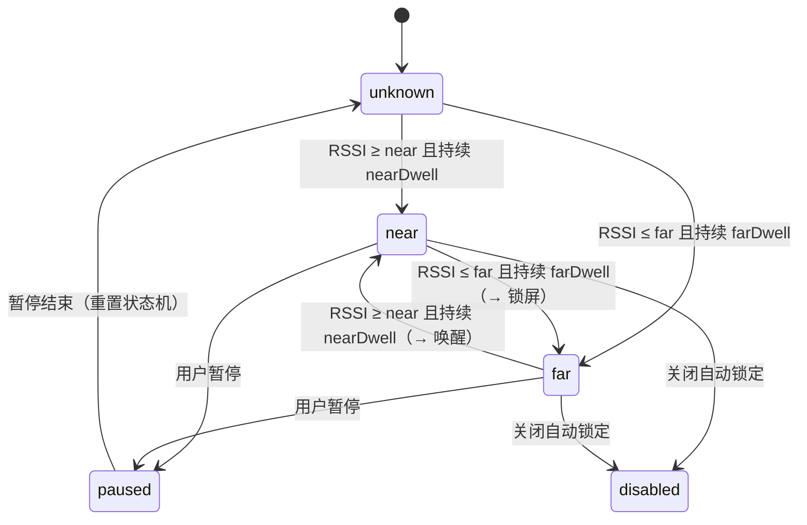

# WatchLock 需求规格说明书（SRS）

> 用 Apple Watch 的蓝牙距离自动锁定 / 唤醒 Mac 的菜单栏应用

| 项目 | 内容 |
| --- | --- |
| 产品名称 | WatchLock |
| 文档版本 | v1.0 |
| 文档状态 | 初稿（待评审） |
| 创建日期 | 2026-10-15 |
| 目标平台 | macOS 14 Sonoma 及以上（Apple Silicon / Intel 通用） |
| 配套设备 | Apple Watch（watchOS 9+，与本机蓝牙可见） |
| 编写人 | 项目初始化阶段由 AI 辅助起草 |

---

## 1. 项目背景与目标

### 1.1 背景

macOS 自带的「使用 Apple Watch 解锁」只解决了**解锁**问题，缺少对等的「离开即锁」能力：

- 系统自带自动解锁依赖 iCloud 同一账户、双因素认证、手表解锁且佩戴等条件，条件不满足时静默失效；
- 用户起身离开工位后，Mac 往往长时间保持解锁状态，存在信息泄露风险；
- 已有的第三方方案（Near Lock、MacID、Unlox 等）多为闭源付费、或依赖 iPhone 中转、或需要托管登录密码。

### 1.2 产品目标

1. **离开即锁**：Apple Watch 超出设定范围（或信号丢失）后，在可配置的宽限时间内自动锁定 Mac。
2. **靠近即醒**：手表回到范围内时点亮显示器，并尽量复用 macOS 原生的 Apple Watch 解锁流程完成解锁。
3. **零干扰**：常驻菜单栏、无 Dock 图标、低耗电、误锁率可控、状态与原因对用户透明可见。
4. **隐私优先**：默认不接触、不上传、不存储用户密码；任何高风险能力默认关闭并明确提示。

### 1.3 非目标（本期不做）

- 不做 iOS / watchOS 配套 App（M3 再评估，见 §14.3）。
- 不做 iCloud / 多设备同步、不做账号体系、不做任何网络上报。
- 不实现「绕过系统密码」的能力；不使用私有 API 做解锁。
- 不做企业管控（MDM）、不做 Windows / Linux 版本。

---

## 2. 术语表

| 术语 | 说明 |
| --- | --- |
| RSSI | Received Signal Strength Indicator，接收信号强度指示，单位 dBm，值越大信号越强（如 -45 强于 -75） |
| EWMA | 指数加权移动平均，用于平滑 RSSI 抖动 |
| 迟滞（Hysteresis） | 近/远双阈值设计，避免临界点来回抖动导致反复锁定 |
| 宽限期（Grace / Dwell） | 状态满足后仍需持续 N 秒才真正执行动作 |
| 托管密码 | 用户主动授权后，将登录密码存入钥匙串，由应用模拟键入完成解锁（高风险，默认关闭） |
| 绑定设备 | 用户在候选列表中指定的那一只 Apple Watch，后续只以它作为判定依据 |
| 信号丢失 | 超过 N 秒未收到任何广播，视为「已离开」 |

---

## 3. 用户画像与使用场景

| 角色 | 特征 | 核心诉求 |
| --- | --- | --- |
| 办公族 A | 开放式工位，频繁起身开会 | 离开工位自动锁屏，回来自动点亮 |
| 开发者 B | 多显示器、长时间编译，偶尔离开 | 可调阈值，避免去茶水间被误锁 |
| 合规敏感用户 C | 公司有锁屏合规要求 | 明确知道何时锁、为什么锁，可导出日志 |

### 3.1 典型场景

**场景 1（主流程，P0）**
1. 用户戴着 Apple Watch 在 Mac 前工作 → 状态栏显示「手表在身边」。
2. 用户起身去会议室，手表信号在 5 秒内持续低于「已离开」阈值。
3. WatchLock 在宽限期结束后执行锁屏，状态栏变为「手表已离开」，并（可选）发送通知。
4. 用户回来坐下，手表进入范围 → 点亮显示器 → 由系统「使用 Apple Watch 解锁」完成解锁（或用户手动输入密码）。

**场景 2（异常：手表没电 / 关机，P1）**
- 超过 `signalLostTimeout`（默认 20 秒）无信号 → 视为离开 → 锁定，且**明确区分**「信号丢失」与「超出距离」两种原因，避免用户以为是 bug。
- **信号丢失反误锁保护（实测问题修复）**：Apple Watch 与 iPhone 连接时广播会被系统节流，手表就在旁边也可能十几秒没有任何广播。因此
  - 丢失前最后一次平滑信号仍强于「在身边」阈值时，超时自动放宽到 `signalLostTimeout × 2.5`；
  - 设置项「收不到信号时按『已离开』锁定」（默认开）可关闭，关闭后只有信号真正变弱（超出距离）才锁定。

**场景 3（异常：开会不希望锁屏，P0）**
- 用户在菜单栏选择「暂停 1 小时」，期间不锁定；暂停到期后自动恢复并在菜单栏显示剩余时间。

**场景 4（异常：刚唤醒就被锁，P1）**
- 系统从睡眠唤醒后进入 `unlockGraceAfterWake`（默认 8 秒）宽限，且重置距离状态机，避免 RSSI 尚未稳定时误锁。

---

## 4. 产品形态与运行环境

| 项 | 要求 |
| --- | --- |
| 形态 | 常驻菜单栏应用（`LSUIElement = true`），无主窗口、无 Dock 图标 |
| 设置入口 | 菜单栏「设置…」+ 快捷键 `⌘,`，或系统设置中的登录项 |
| 系统版本 | macOS 14.0+（`MenuBarExtra` / `SMAppService` 依赖） |
| 架构 | 通用二进制（arm64 + x86_64） |
| 权限 | 蓝牙（必需）；辅助功能（使用默认「⌃⌘Q」锁屏或托管密码时必需）；通知（可选） |
| 沙箱 | 开启 App Sandbox + `com.apple.security.device.bluetooth` |
| 分发 | 开发期 ad-hoc 签名本地运行；正式分发需 Developer ID 签名 + 公证 + DMG |

---

## 5. 总体技术方案

### 5.1 链路

```
Apple Watch(BLE 广播)
      │  CoreBluetooth 持续扫描（allowDuplicates=true）
      ▼
WatchScanner ──(RSSI 样本)──▶ ProximityEngine ──(near/far 事件)──▶ AppSession
                                                                      │
                                              ┌───────────────────────┴────────────┐
                                              ▼                                    ▼
                                        ScreenLocker                          UnlockService
                                  (CGSession -suspend 等)              (点亮屏幕 / 引导系统自动解锁)
```

### 5.2 距离判定状态机



### 5.3 关键约束（必须写进设计，避免后期踩坑）

| 约束 | 说明 | 应对 |
| --- | --- | --- |
| Apple 未提供第三方自动解锁 API | 无法在第三方进程内完成「免密解锁」 | 解锁走「点亮屏幕 + 系统原生自动解锁」；托管密码作为可选高风险方案 |
| Apple Watch 广播不稳定 | 手表与 iPhone 连接时广播内容受限，设备名可能不可见 | 多证据识别（名称 / 厂商数据 / 服务 UUID）+ 用户手动绑定；M3 评估 watchOS 配套 App |
| 蓝牙 RSSI 受遮挡影响大 | 人体、金属、显示器都会造成 5–15 dBm 波动 | EWMA 平滑 + 双阈值迟滞 + 宽限期 + 可校准 |
| macOS 无公开锁屏 API | 只有工程手段 | 默认 `CGSession -suspend`，可切换 `pmset` 或自定义命令（见 §7.6） |
| 沙箱内 Apple Events 受限 | 托管密码需要 Apple Events + 辅助功能 | 该功能默认关闭，且需要用户在系统设置中显式授权 |

---

## 6. 功能需求总览

| 编号 | 需求 | 优先级 | 里程碑 |
| --- | --- | --- | --- |
| FR-01 | 首次启动权限引导（蓝牙） | P0 | M1 |
| FR-02 | Apple Watch 发现与绑定 | P0 | M1 |
| FR-03 | 距离测量与状态判定 | P0 | M1 |
| FR-04 | 离开自动锁定 | P0 | M1 |
| FR-05 | 靠近唤醒 / 解锁 | P1 | M2 |
| FR-06 | 临时暂停与恢复 | P0 | M1 |
| FR-07 | 菜单栏状态与控制 | P0 | M1 |
| FR-08 | 设置界面 | P0 | M1 |
| FR-09 | 系统通知 | P2 | M2 |
| FR-10 | 开机启动 | P2 | M2 |
| FR-11 | 诊断日志与导出 | P1 | M1 |
| FR-12 | 低耗电与性能优化 | P1 | M2 |
| FR-13 | 睡眠/唤醒/锁屏事件联动 | P1 | M2 |
| FR-14 | 距离校准向导 | P2 | M3 |
| FR-15 | 本地化（简中 / 英文） | P2 | M4 |
| FR-16 | 误锁反馈与自动调参 | P1 | M3 |
| FR-17 | 调试用 RSSI 模拟（开发辅助） | P2 | M3 |

---

## 7. 功能需求详情

### FR-01 首次启动与权限引导（P0）

1. 首次启动弹出引导页，说明需要的权限与用途。
2. 蓝牙权限：通过 `CBCentralManager` 初始化触发系统授权；未授权时菜单栏显示红色提示并提供「打开系统设置」按钮。
3. 蓝牙关闭时提示用户开启，自动重试扫描（状态变为 `.poweredOn` 后自动恢复）。
4. **验收标准**：
   - 未授权时应用不崩溃，菜单栏可见明确的修复指引；
   - 授权并开启蓝牙后，无需重启应用即可开始扫描。

### FR-02 Apple Watch 发现与绑定（P0）

1. 持续扫描 BLE 外设（`allowDuplicates = true` 以获取连续 RSSI）。
2. 候选识别采用多证据规则（满足任一即入选）：
   - 名称包含 `Apple Watch` / `watch`（不区分大小写）；
   - 厂商数据公司 ID 为 `0x004C`（Apple），并解析其中的 Continuity 广播结构（类型字节 + 声明长度，见 `AppleAdvertisement`）；
   - 命中已知 Apple 相关服务 UUID（ANCS / AMS / Continuity）；
   - 已被用户绑定（始终保留）。
3. 设置页展示候选列表（名称、RSSI、命中依据），支持「绑定 / 解绑」，绑定后仅以该设备 ID 作为判定依据。
4. 30 分钟未出现的外设从列表移除。
5. **验收标准**：
   - 手表在附近时 30 秒内出现在候选列表；
   - 绑定后重启应用仍生效（持久化 `boundWatchID`）；
   - 绑定其他设备后，原设备信号不再影响判定。

### FR-03 距离测量与状态判定（P0）

1. RSSI 使用 EWMA 平滑，平滑系数默认 0.25，可配置（0.05–1.0）。
2. 近/远双阈值：默认「在身边」≥ -55 dBm，「已离开」≤ -70 dBm。
3. 状态切换需满足持续时间：离开默认 5 秒，靠近默认 1 秒。
4. 信号丢失超时（默认 20 秒）视为离开；丢失前信号很强时放宽到 2.5 倍。
5. 提供距离估算（对数路径损耗模型），1 米处标定值默认 -55 dBm，路径损耗指数默认 2.5，均可配置。
6. **验收标准**：
   - 在临界值附近来回移动时，1 分钟内不出现「锁屏—解锁」抖动；
   - 输入固定 RSSI 序列的单元测试覆盖：平滑、迟滞、超时三类行为。

### FR-04 离开自动锁定（P0）

1. 触发条件全部满足才执行锁定：
   - 功能开关已开启且未处于暂停；
   - 不在唤醒宽限期内；
   - 当前屏幕未锁定（通过 `com.apple.screenIsLocked/Unlocked` 与 `screensDidSleep/Wake` 判定）。
2. 锁定方式可配置（默认 `CGSession -suspend`）：

| 方式 | 命令 | 适用场景 |
| --- | --- | --- |
| 锁定屏幕（默认） | `CGSession -suspend` | 与系统锁屏一致，唤醒需密码 |
| 仅关闭显示器 | `pmset displaysleepnow` | 只想熄屏、不锁会话 |
| 进入睡眠 | `pmset sleepnow` | 期望整机休眠省电 |
| 自定义命令 | 用户填写 | 对接企业脚本 |

3. 执行失败时记录日志并（可选）通知，不重复高频重试。
4. **验收标准**：
   - 手表关机 15 秒后 Mac 进入锁定状态，日志中可见原因；
   - 已锁屏状态下不会重复触发锁屏命令；
   - 暂停期间即使手表离开也不锁定。

### FR-05 靠近唤醒与解锁（P1）

1. 靠近事件触发时点亮显示器：`caffeinate -u -t 1`（模拟用户活动）。
2. 解锁策略三选一，默认「系统自动解锁（推荐）」：

| 策略 | 行为 | 风险 |
| --- | --- | --- |
| 仅唤醒屏幕 | 只点亮显示器，解锁交给用户或系统 | 无 |
| 系统自动解锁（默认） | 点亮 + 检查系统前置条件（锁屏后是否要求立即输入密码等），缺失时引导到系统设置 | 无 |
| 托管密码自动输入 | 从钥匙串读取密码，Apple Events 模拟键入 | 高：需辅助功能权限，密码以 `WhenUnlockedThisDeviceOnly` 存钥匙串，系统更新可能失效 |

3. 必须在 UI 上明示：Apple 未开放第三方自动解锁 API，最可靠路径是开启系统「使用 Apple Watch 解锁」。
4. **验收标准**：
   - 默认策略下靠近后显示器点亮，且不会尝试写入/读取任何密码；
   - 托管密码关闭时不读取钥匙串；开启时若无辅助功能权限，明确报错并给出授权入口。

### FR-06 临时暂停与恢复（P0）

1. 支持暂停 15 分钟 / 1 小时 / 4 小时，或手动「恢复」。
2. 暂停期间菜单栏显示状态与到期时间，暂停结束自动恢复。
3. 暂停状态持久化，应用重启后仍生效。

### FR-07 菜单栏状态与控制（P0）

1. 常驻图标随状态变化：`搜索中 / 已解锁 / 已锁定 / 暂停 / 关闭`。
2. 面板内容：状态标题、绑定设备名、信号强度、估算距离、最后更新时间、蓝牙异常提示。
3. 快捷操作：启用开关、暂停菜单、立即锁定、设置、退出。

### FR-08 设置界面（P0）

| 页签 | 内容 |
| --- | --- |
| 通用 | 启用开关、近/远阈值、离开等待、信号丢失超时、锁定方式及自定义命令、菜单栏文字、通知、开机启动 |
| 设备 | 已绑定设备、候选列表与绑定/解绑、排查提示 |
| 解锁 | 点亮屏幕开关、解锁策略、唤醒宽限、托管密码录入（高风险）、系统自动解锁引导入口 |
| 高级 | 距离模型校准（1m 标定值、路径损耗指数、平滑系数）、诊断日志（查看/清空/导出） |
| 关于 | 版本、用途说明、仓库链接 |

### FR-09 系统通知（P2）

1. 触发时机：执行自动锁定、蓝牙被关闭、权限缺失、自动解锁前置条件缺失。
2. 通知频率限制：同一原因 5 分钟内最多 1 条。
3. 可在设置中整体关闭。

### FR-10 开机启动（P2）

1. 使用 `SMAppService.mainApp`（macOS 13+）注册/注销登录项，失败时记录日志。
2. 设置项与系统登录项状态保持一致显示。

### FR-11 诊断日志与导出（P1）

1. 内存环形日志，最多 300 条，含时间戳与级别（信息/警告/错误）。
2. 记录：启动退出、扫描状态变化、阈值切换、锁定触发与原因、权限错误、解锁失败。
3. 支持「高级」页查看、清空、导出为 `.txt`（用户自选路径）。
4. 日志中**不得**出现密码、钥匙串内容。

### FR-12 低耗电与性能（P1）

| 指标 | 目标 |
| --- | --- |
| 常驻 CPU 占用（1 分钟均值） | < 1% |
| 常驻内存 | < 60 MB |
| 电池影响（`powermetrics` 对比） | 不明显高于同类蓝牙工具类应用 |
| 状态刷新间隔 | 1 秒（结算），RSSI 由广播驱动 |
| 二进制体积 | < 5 MB |

### FR-13 睡眠 / 唤醒 / 锁屏事件联动（P1）

1. 监听 `NSWorkspace` 的 willSleep / didWake / screensDidSleep / screensDidWake，以及分布式通知 `com.apple.screenIsLocked` / `screenIsUnlocked`。
2. 唤醒后进入宽限期并重置距离状态机，避免 RSSI 未稳定时误锁。
3. 睡眠期间停止扫描，唤醒后恢复。

### FR-14 距离校准向导（P2，M3 → 已提前交付）

1. 引导用户把手表放在 1 米处采样 10 秒，自动写入 `measuredPower`。
2. 支持「在此处算作在身边 / 已离开」两点标定，自动生成阈值。
3. **实现说明**：采样结果取中位数抑制离群值；两点标定按「在身边中位数 - 3 dBm / 已离开中位数 + 3 dBm」生成阈值，并保证两者至少相差 8 dBm（不足时优先下压「已离开」阈值以降低误锁率）。入口在「设置 → 高级 → 距离校准向导」。

### FR-16 误锁反馈与自动调参（P1，M3）

1. 每次自动锁定记一次样本；用户在菜单栏点击「刚才这次是误锁」记一次误锁（锁定后 10 分钟内可反馈）。
2. 误锁率 > 20% 且样本 ≥ 3 时自动放宽：先把「已离开」阈值下调 2 dBm（下限 -95），到下限后把等待时间 +2 秒（上限 30 秒）。
3. 连续 20 次自动锁定无误锁时缓慢收紧：先缩短等待时间，再向默认阈值移动 1 dBm；收紧后不会比默认行为更激进，也不会与「在身边」阈值贴太近（至少保留 5 dBm）。
4. 「高级」页展示自动锁定次数 / 误锁次数 / 误锁率，并提供「恢复默认阈值」。
5. **实现说明**：调参逻辑为纯函数 `AutoTuner`，有单元测试；样本计数持久化在 `UserDefaults`。

### FR-17 调试用 RSSI 模拟（P2，M3）

1. 菜单栏「调试」子菜单可注入固定 RSSI（在身边 / 边界 / 离开）或模拟信号丢失，用于无需走动即可验证状态机与锁屏链路。
2. 支持环境变量 `WATCHLOCK_FAKE_RSSI=<dBm>` 在启动时持续注入。
3. 模拟期间忽略真实广播，避免两者相互干扰；开关受「设置 → 通用 → 菜单栏显示调试子菜单」控制，默认关闭。

### FR-15 本地化（P2，M4）

1. 简体中文、英文两套文案，随系统语言切换。

---

## 8. 非功能需求

| 编号 | 类别 | 需求 |
| --- | --- | --- |
| NFR-01 | 安全 | 默认不收集/不上传任何数据；无网络能力；密码仅存钥匙串且 `WhenUnlockedThisDeviceOnly`；日志脱敏 |
| NFR-02 | 可靠 | 蓝牙异常、权限缺失、命令执行失败均不崩溃；关键路径有日志 |
| NFR-03 | 可维护 | 分层清晰（UI / Session / Core / Storage），核心状态机有单元测试 |
| NFR-04 | 兼容 | macOS 14/15/26 三档验证；Apple Silicon 与 Intel 双架构 |
| NFR-05 | 可用 | 首次配置 3 步内完成（授权 → 绑定 → 设定阈值）；默认参数开箱可用 |
| NFR-06 | 无障碍 | 支持 VoiceOver 可读的状态文案与控件标签 |
| NFR-07 | 可观测 | 所有锁定动作可追溯（时间 + 原因 + RSSI） |

---

## 9. 数据模型

| 对象 | 字段 | 持久化 |
| --- | --- | --- |
| `DiscoveredWatch` | id(UUID)、name、rssi、lastSeen、matchReasons | 内存 |
| `SettingsStore` | isEnabled、boundWatchID/Name、nearRSSI、farRSSI、smoothing、farDwell、nearDwell、signalLostTimeout、measuredPower、pathLossExponent、lockMethod、customLockCommand、unlockStrategy、wakeDisplayOnApproach、unlockGraceAfterWake、pauseUntil、launchAtLogin、showRSSIInMenuBar、notificationsEnabled、debugLogging | `UserDefaults` |
| `ProximityEngine.Config` | 由设置派生 | 内存 |
| 登录密码 | — | 钥匙串 `com.watchlock.login-password`（仅托管模式） |
| 诊断日志 | 时间戳、级别、消息 | 内存（可导出） |

默认值：

| 参数 | 默认值 | 说明 |
| --- | --- | --- |
| `nearRSSI` | -55 dBm | 判定「在身边」 |
| `farRSSI` | -70 dBm | 判定「已离开」 |
| `smoothing` | 0.25 | EWMA 系数 |
| `farDwell` | 5 s | 离开持续时间 |
| `nearDwell` | 1 s | 靠近持续时间 |
| `signalLostTimeout` | 20 s | 信号丢失超时（手表在旁边但广播被节流时放宽到 2.5 倍） |
| `lockOnSignalLoss` | true | 收不到信号时是否按「已离开」锁定 |
| `measuredPower` | -55 dBm | 1 米标定 |
| `pathLossExponent` | 2.5 | 路径损耗指数 |
| `unlockGraceAfterWake` | 8 s | 唤醒宽限 |

---

## 10. 界面需求

### 10.1 菜单栏面板（宽 320pt）

```
┌──────────────────────────────────────┐
│ 🔓  手表在身边                        │
│     Apple Watch Ultra                │
│ ──────────────────────────────────── │
│ 信号强度                     -52 dBm │
│ 估算距离                      0.8 米 │
│ 最后更新                      2 秒前 │
│ ──────────────────────────────────── │
│ [✓] 启用自动锁定                     │
│ [ 暂停… ]        [ 立即锁定 ]        │
│ [ 设置… ⌘, ]     [ 退出 WatchLock ]  │
└──────────────────────────────────────┘
```

### 10.2 设置窗口（560 × 460）

五个页签：通用 / 设备 / 解锁 / 高级 / 关于（见 FR-08 表）。

### 10.3 视觉与交互

- 遵循系统强调色与深色模式，不使用自定义主题；
- 危险操作（托管密码、解除绑定）需二次确认或明确警示文案；
- 所有开关即时生效，无需重启应用。

---

## 11. 权限与隐私清单

| 权限 | 必需性 | 用途 | Info.plist 键 |
| --- | --- | --- | --- |
| 蓝牙 | 必需 | 扫描 Apple Watch 并读取 RSSI | `NSBluetoothAlwaysUsageDescription` |
| 通知 | 可选 | 锁定/异常提醒 | `NSUserNotificationUsageDescription` |
| Apple Events | 可选（仅托管密码） | 模拟键入登录密码 | `NSAppleEventsUsageDescription` |
| 辅助功能 | 使用「⌃⌘Q」锁屏（默认）或托管密码时必需 | System Events 模拟按键；缺失时锁定被拦截并通知用户，授权需用户手动勾选（分发包无法预授权，除非 MDM 下发 PPPC） | — |
| 网络 | 无 | 应用不发起任何网络请求 | — |

---

## 12. 关键决策记录（ADR 摘要）

| 编号 | 决策 | 备选方案 | 理由 |
| --- | --- | --- | --- |
| ADR-01 | 用 BLE RSSI 做距离判定 | UWB / Wi-Fi RTT / 摄像头人感 | 仅 Apple Watch Series 6+ 支持 UWB 且不向第三方开放；RSSI 是唯一通用可行方案 |
| ADR-02 | 锁屏用 `CGSession -suspend` | 私有 `SACLockScreenImmediate` | 前者为公开可执行程序，App Store 风险更低；后者为私有 API |
| ADR-03 | 解锁默认不托管密码 | 托管密码为默认 | 安全优先；Apple 未开放第三方解锁 API，托管密码存在泄漏与失效风险 |
| ADR-04 | SwiftPM 工程 + 脚本打包 .app | Xcode .xcodeproj | 便于命令行构建与 CI；GUI 相关资源由 `Scripts/build-app.sh` 注入 Info.plist 与 entitlements |
| ADR-05 | SwiftUI `MenuBarExtra` | NSStatusItem 手写 | 代码量小、macOS 14+ 原生支持 `.window` 样式面板 |
| ADR-06 | 状态判定用双阈值 + 宽限 | 单一阈值 | 抑制临界抖动，降低误锁率 |
| ADR-07 | 本期不实现 watchOS 配套 App | 手表端主动广播 / iPhone 中转 | 后台广播持续性无保证、签名与维护成本高；现有多证据识别 + 校准 + 误锁调参已覆盖主要问题。评估全文见 `docs/watchos-companion-evaluation.md` |
| ADR-08 | 定位为「离开即锁屏」，不追求复刻 Apple 官方识别可靠性 | 自己实现手表在场判定 + 解锁 | Apple 官方「用 Apple Watch 解锁」依赖 iCloud 身份 + 双重认证 + Continuity，第三方无对应 API；官方方案只覆盖解锁、不覆盖离开锁屏，本项目补的正是这一段。依据见 `docs/anti-false-lock-research.md` |

---

## 13. 里程碑与交付计划

| 里程碑 | 版本 | 内容 | 产出 |
| --- | --- | --- | --- |
| M1 | v0.1.0 | FR-01/02/03/04/06/07/08/11 骨架实现 + 构建脚本 | 可运行的 .app |
| M2 | v0.2.0 | FR-05/09/10/12/13，补 `ProximityEngine` 单元测试 | 完整主流程可用 |
| M3 | v0.3.0 | FR-14 校准向导、FR-16 误锁反馈与自动调参、FR-17 调试模拟、评估 watchOS 配套 App | 精度与体验优化（**已完成**，当前阶段） |
| M4 | v1.0.0 | FR-15 本地化、Developer ID 签名与公证、DMG、帮助手册 | 对外发布 |

### 13.1 当前代码与需求的对照

| 需求 | 状态 | 位置 |
| --- | --- | --- |
| FR-02 扫描与绑定 | 已实现（多证据识别 + Continuity 广播解析 + 地址轮换时用广播类型指纹校验续接） | `Core/Bluetooth/WatchScanner.swift`、`Core/Bluetooth/AppleAdvertisement.swift` |
| 广播抓包（真机固化识别规则） | 已实现（「高级」页展示厂商数据并支持复制） | `UI/SettingsView.swift` |
| FR-03 距离判定 | 已实现 | `Core/Proximity/ProximityEngine.swift` |
| FR-04 自动锁定 | 已实现 | `Core/Lock/ScreenLocker.swift`、`App/AppSession.swift` |
| FR-05 唤醒解锁 | 已实现（策略骨架，需真机调优） | `Core/Unlock/UnlockService.swift` |
| FR-06 暂停 | 已实现 | `Storage/SettingsStore.swift` |
| FR-07/08 UI | 已实现 | `UI/MenuBarView.swift`、`UI/SettingsView.swift` |
| FR-11 日志 | 已实现 | `Support/DiagnosticsLog.swift` |
| FR-09 通知 | 已实现（含授权请求与「同一原因 5 分钟 1 条」限流） | `Support/NotificationPresenter.swift`、`Support/NotificationThrottle.swift` |
| FR-10 开机启动 | 已实现（设置项与系统登录项状态同步） | `Core/System/LaunchManager.swift`、`UI/SettingsView.swift` |
| FR-01 首次引导页 | 已实现（授权 → 绑定 → 确认参数 3 步向导，「关于」页可重跑） | `UI/OnboardingView.swift` |
| FR-13 睡眠联动 | 已实现（睡眠停止扫描、唤醒恢复扫描并重置状态机） | `Core/System/SleepWakeMonitor.swift`、`App/AppSession.swift` |
| FR-12 低耗电 | 已实现（暂停/关闭时改为间歇扫描、候选 60 秒清理、前置条件探测结果缓存） | `Core/Bluetooth/WatchScanner.swift`、`App/AppSession.swift` |
| FR-14 距离校准向导 | 已实现（1 米标定 + 两点标定生成阈值，采样 10 秒） | `Core/Proximity/DistanceCalibrator.swift`、`UI/CalibrationWizard.swift` |
| FR-16 误锁反馈与自动调参 | 已实现（菜单栏反馈入口 + `AutoTuner` 纯逻辑 + 高级页统计与恢复默认） | `Core/Proximity/AutoTuner.swift`、`App/AppSession.swift`、`UI/MenuBarView.swift` |
| FR-17 调试用 RSSI 模拟 | 已实现（调试子菜单 + `WATCHLOCK_FAKE_RSSI` 环境变量，默认关闭） | `App/AppSession.swift`、`UI/MenuBarView.swift` |
| watchOS 配套 App | 已评估，结论「本期不实现」（保留为兜底方案，触发条件见评估文档） | `docs/watchos-companion-evaluation.md` |
| 单元测试 | 已实现（78 个用例，覆盖状态机 / 命令拼装 / 识别规则 / 限流 / 设置 / 校准 / 调参 / 广播解析） | `Tests/WatchLockTests` |

---

## 14. 测试与验收

### 14.1 单元测试（M2 已补充：`Tests/WatchLockTests`，`swift test` 共 78 例）

| 用例 | 输入 | 期望 |
| --- | --- | --- |
| RSSI 平滑 | 序列 -70,-50,-70,-50 | 输出介于极值之间，无跳变 |
| 离开迟滞 | RSSI 在 -69/-71 间抖动 | 不触发锁定 |
| 离开锁定 | 持续 -75 超过 5 秒 | 触发一次 `becameFar` |
| 信号丢失 | 12 秒无样本 | 触发一次 `becameFar` |
| 靠近恢复 | 持续 -50 超过 1 秒 | 触发一次 `becameNear` |
| 距离估算 | RSSI = -55 | ≈ 1.0 米 |
| 锁屏命令拼装 | 各 `LockMethod` | 命令字符串符合预期 |
| AppleScript 转义 | 密码含 `"` `\` | 转义结果可被 `osascript` 正确解析 |
| 校准中位数 | -50 / -52 | -51（偶数取中间两数均值） |
| 两点标定 | 在身边 -50、已离开 -75 | 生成 -53 / -72，且两点能被正确分类 |
| 误锁调参 - 放宽 | 5 次锁定中 2 次误锁 | 已离开阈值 -70 → -72 |
| 误锁调参 - 收紧 | 连续 20 次无误锁、当前 -75 | 向默认阈值移动 1 dBm（-74），且不会比默认更激进 |

### 14.2 手工验收清单

1. 全新系统安装后启动，蓝牙授权流程可走通；
2. 绑定手表后，把手表带到 5 米外，观察锁定时间与日志；
3. 回到座位，显示器自动点亮，系统自动解锁（或提示缺失条件）；
4. 合盖休眠 30 秒后开盖，8 秒内不被误锁；
5. 关闭蓝牙 → 菜单栏出现提示 → 重新开启后自动恢复扫描；
6. 暂停 15 分钟期间，手表离开不锁屏；
7. 活动监视器中 CPU/内存符合 NFR-12。

### 14.3 兼容性矩阵

| 组合 | 需验证 |
| --- | --- |
| macOS 14 / 15 / 26 × Apple Silicon | ✅ |
| macOS 15 × Intel（有蓝牙模块） | ✅ |
| Apple Watch S6~S10 / Ultra / SE | ✅ |
| 手表与 iPhone 已配对（常见状态） | ✅ 广播识别准确性 |
| 多显示器 / 外接蓝牙设备 | ✅ 干扰场景 |

---

## 15. 风险与已知限制

| 编号 | 风险 | 影响 | 缓解 |
| --- | --- | --- | --- |
| R-01 | Apple 未开放第三方自动解锁 API，解锁体验依赖系统功能 | 高 | 默认策略改为「唤醒 + 引导系统设置」；在 UI 明确说明 |
| R-02 | Apple Watch 广播内容与可见性随 watchOS 变化；且以随机地址 + IRK 广播，第三方拿不到 IRK | 高 | 多证据识别 + 手动绑定 + 校准向导 + 误锁自动调参 + 地址轮换自动续接绑定；watchOS 配套 App 已评估为兜底方案（本期不实现，触发条件见 `docs/watchos-companion-evaluation.md`）；调研依据见 `docs/anti-false-lock-research.md` |
| R-03 | RSSI 受遮挡/人体影响，误锁或漏锁 | 中 | 平滑 + 双阈值 + 宽限 + 校准向导 + 暂停 |
| R-04 | `CGSession -suspend` 在后续 macOS 版本失效 | 中 | 锁屏方式可配置，失效时可切 `pmset` 或自定义命令 |
| R-05 | 托管密码模式的安全与合规风险 | 高 | 默认关闭、二次警示、钥匙串最小权限、日志脱敏 |
| R-06 | 沙箱 + 蓝牙权限在部分系统设置组合下不生效 | 中 | 提供诊断页与权限自检入口 |
| R-07 | 公证/签名失败导致无法分发 | 低 | M4 提前验证 Developer ID + notarytool 流程 |

---

## 16. 附录

### 16.1 参考竞品

| 产品 | 思路 | 启示 |
| --- | --- | --- |
| Near Lock | iPhone + Watch 双通道，Mac 端 BLE | 距离判定 + 手动暂停的组合已被验证 |
| MacID | 依赖 iOS App 中转 | 可靠性高，但需要手机常驻 App |
| Unlox | Watch 端 App + Mac 端解锁 | 说明 watchOS 配套 App 是精度兜底方案 |

### 16.2 相关 Apple 文档

- CoreBluetooth 编程指南（CBCentralManager / 扫描选项）
- `SMAppService`（登录项）
- `SecItemAdd` / `SecItemUpdate`（钥匙串）
- macOS 「使用 Apple Watch 解锁」系统设置项

### 16.3 变更记录

| 版本 | 日期 | 说明 |
| --- | --- | --- |
| v1.0 | 2026-10-15 | 初稿，覆盖 M1–M4 规划与当前实现对照 |
| v1.1 | 2026-10-15 | M2 完成：补 FR-01 引导页、FR-09 通知限流、FR-12 低耗电扫描、FR-13 睡眠联动、开机启动状态同步，并新增 XCTest 单元测试（31 例） |
| v1.2 | 2026-10-15 | 提前交付 M3 的 FR-14：距离校准向导（1 米标定 + 两点标定），补充校准计算单测（累计 38 例） |
| v1.3 | 2026-10-15 | 新增 FR-16 误锁反馈与自动调参、FR-17 调试用 RSSI 模拟；完成 watchOS 配套 App 评估（结论：本期不实现，ADR-07）；单测累计 60 例 |
| v1.4 | 2026-10-15 | 修复实测问题「手表在旁边却锁屏」：信号丢失超时默认 12 → 20 秒且丢失前信号强时放宽 2.5 倍、新增「收不到信号时锁定」开关、绑定后自动校准阈值、蓝牙地址轮换（RPA）自动续接绑定、菜单栏显示锁定原因；单测累计 68 例 |
| v1.5 | 2026-10-15 | 补做调研（Apple 官方文档 / 开发者论坛一手报告 / Continuity 逆向研究 / 同类产品），修正 v1.4 中不准确的机制表述，新增 ADR-08 明确产品定位，调研依据见 `docs/anti-false-lock-research.md` |
| v1.6 | 2026-10-15 | 选定「纯 Mac 单端 + 认广播类型」路线：新增 `AppleAdvertisement` 解析 Continuity 广播结构、绑定时记录广播类型指纹并在地址轮换时校验、高级页新增广播抓包入口；单测累计 78 例 |
| v1.7 | 2026-10-15 | 本机真机抓包（12 秒 / 283 台设备）后修正：广播类型指纹去掉会变化的长度、RSSI=127 时按「在场」处理不再误锁、诊断日志落盘、抓包区改为直接读扫描结果；单测累计 81 例 |
